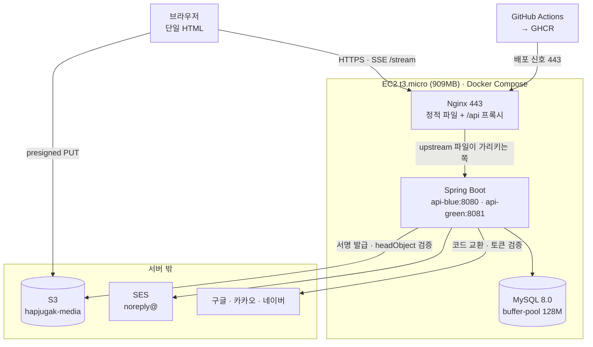
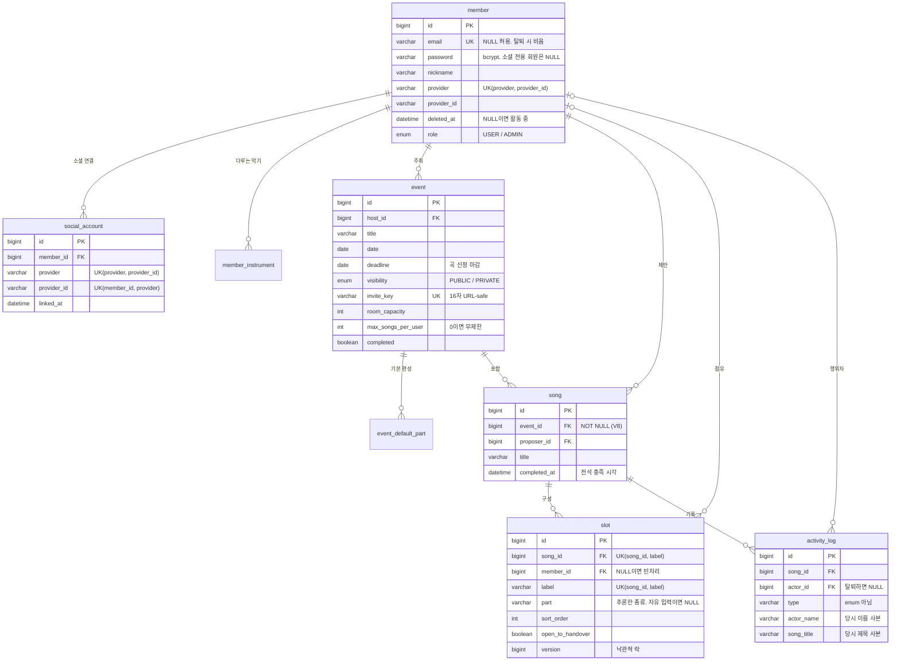

# 합주각 (Hapjugak)

밴드 합주 멤버를 파트별로 모으는 서비스입니다. Firebase로 먼저 배포해 두 달 반 운영한 뒤, 운영 중 부딪힌 한계를 근거로 백엔드를 직접 만들어 재배포했습니다.

서비스 주소는 https://hapjugak.com 입니다.

---

## 개발자

장준호 · 백엔드 개발자 지원 · [github.com/SaAe1101](https://github.com/SaAe1101)

제가 쓸 서비스를 먼저 배포해서 사용자를 받고, 거기서 나온 문제를 근거로 다음 기술을 고릅니다. 합주각도 Spring을 써보려고 만든 쪽은 아닙니다. Firebase로 두 달 반 운영하면서 동시성과 검증, 조회에서 막힌 뒤에 옮겼습니다.

---

## 프로젝트 개요

| | |
|---|---|
| 기간 | 2026.08 ~ 운영 중 (Firebase 2.5개월 운영 후 10월 백엔드 재구축) |
| 인원 | 1명 |
| 역할 | 기획, 프론트엔드, 백엔드, DB 설계, 인프라, 배포 전 과정 |
| 이관 규모 | 회원 26, 곡 80, 파트 자리 398, 활동 로그 270 (2026.10 이관 시점) |
| 운영 환경 | AWS EC2 1대 (t3.micro, ap-southeast-2), 월 약 $10 |
| 코드 규모 | 백엔드 6,755줄, 테스트 2,392줄(109개), 프론트 단일 HTML 6,020줄 |

---

## 왜 만들었나

합주각은 여러 명이 모인 풀에서 매번 다른 조합으로 합주팟을 짜는 모임을 위한 서비스입니다. 고정 멤버끼리 하는 밴드와 달리 이런 모임은 누가 어느 곡에 어떤 파트로 들어갈지를 매번 처음부터 정해야 합니다. 사람이 많아질수록 그 조율이 어려워집니다.

### 한 곡도 성사되지 않습니다

날짜를 잡고 단톡방에 "할 곡 추천받아요"를 올리면 추천곡이 우르르 올라옵니다. 스무 곡 넘게 쌓이기도 합니다. 여기까지는 괜찮은데, 그다음에 사람들이 각자 자기가 제일 하고 싶은 곡에만 손을 듭니다.

```
A곡 — 보컬 1
B곡 — 드럼 1
C곡 — 기타 1, 베이스 1
D곡 — 보컬 1
 ⋮     스무 곡에 한두 명씩 흩어짐
        → 한 곡도 성사되지 않음
```

사람은 충분한데 한 곡도 못 맞춥니다.

### 왜 흩어지는가

지금 어느 곡에 누가 어떤 파트로 들어가 있는지 볼 방법이 없기 때문이라고 봤습니다.

C곡에 기타 한 명만 더 들어오면 합주가 성사된다고 해봅시다. 기타 치는 사람 입장에서 C곡이 1픽이 아니어도, 한 자리만 채우면 성사된다는 걸 알면 들어갈 마음이 생깁니다. 그런데 그 정보가 어디에도 없습니다. 단톡방 수백 개 메시지를 거슬러 올라가며 직접 집계해야 알 수 있고, 아무도 그걸 하지 않습니다.

그래서 다들 자기 1픽에만 손을 들고, 모든 곡이 미완성으로 남습니다.

### 실제로 벌어진 일

합주실은 이미 예약해둔 상태에서 곡이 안 정해졌습니다. 현장에 모여서 "우리 오늘 뭐 하지", "이건 누가 치지"를 그 자리에서 정했습니다. 빌린 시간은 그동안 흘러갑니다.

스케줄 안내도 매번 수동이었습니다. 날짜와 합주실, 시간, 참가비를 단톡방에 올리고, 못 본 사람에게 따로 알려주고, 바뀌면 또 올렸습니다.

### 그래서 만든 것

단톡방에 메시지로 흩어져 있던 것들을 전부 상태로 들고 있게 만들었습니다. 곡 추천부터 자리 선점, 성립 여부, 일정 안내까지 한 화면에서 보이고 눌리도록 했습니다.

서비스를 떠받치는 기둥은 넷입니다.

| 기둥 | 겪은 문제 | 기능 |
|---|---|---|
| 곡 추천을 한곳에 모읍니다 | 추천곡이 메시지 사이에 묻혀 뭐가 나왔는지도 모름 | 일정마다 곡 목록이 쌓입니다 |
| 자리를 눈에 보이게 만듭니다 | 누가 어느 곡 어느 파트인지 집계가 안 됨 | 곡마다 파트 자리를 만들어 점유자와 빈자리를 함께 보여줍니다 |
| 자리를 선점할 수 있게 합니다 | 같은 파트에 두 명이 신청하고, 이탈 메시지는 묻힘 | 한 자리에 한 명. 찬 자리는 버튼이 막히고, 못 가게 되면 양도로 넘깁니다 |
| 성립 여부를 알려줍니다 | 수요가 흩어져 한 곡도 성사되지 않음 | 다 차면 성립 표시가 붙고, 비어 있는 파트로 곡을 거를 수 있습니다 |

여기에 세 가지가 더 붙습니다.

| 겪은 문제 | 기능 |
|---|---|
| 합주 직전에 곡이 추가됨 | 일정마다 곡 신청 마감일이 있고, 지나면 서버가 거부합니다 |
| 스케줄 안내가 매번 수동 | 날짜, 합주실, 시간, 참가비, 정원을 일정에 담고, 바뀌면 접속 중인 모든 화면이 즉시 갱신됩니다 |
| 지난달에 뭘 했는지 아무도 기억 못 함 | 끝난 합주는 추억 저장소로 넘어가 곡과 참여자가 남습니다 |

뒤에 나오는 기술 선택은 전부 이 넷을 성립시키려고 한 것들입니다. 자리를 보이게 하려고 `slot`을 별도 테이블로 뺐고, 선점을 지키려고 낙관적 락을 걸었고, 성립 여부로 거르려고 `hasOpenPart` 동적 검색을 넣었습니다. 그 네 가지가 모든 사람 화면에서 동시에 맞으려고 SSE를 붙였습니다.

---

## 기술 스택

| 구분 | 기술 |
|---|---|
| 깊게 다룬 것 | Java 17, Spring Boot 4.1.2, Spring Data JPA (Hibernate 7), MySQL 8.0, QueryDSL 7.4, Spring Security + JWT, JUnit 5 |
| 직접 구성해 운영 중인 것 | Docker Compose, Nginx, AWS EC2, AWS S3, AWS SES, GitHub Actions, Flyway, SSE, Let's Encrypt |
| 써본 것 | Firebase (Auth, Firestore), Netlify |

### 선택 이유

**QueryDSL.** 곡 검색에 조건 세 개(키워드, 비어 있는 파트, 일정)가 들어가고 여기에 뷰어별 공개 범위 조건이 더 붙습니다. 메서드 이름 기반 쿼리로는 조합마다 메서드가 필요한데, QueryDSL은 조건이 `null`이면 무시하므로 코드 한 벌로 처리됩니다. 조건이 없는 단순 CRUD에는 그대로 기본 메서드를 씁니다. 원본(`com.querydsl`)은 유지보수가 멈춰 Hibernate 7과 맞지 않아 OpenFeign 포크를 썼습니다.

**낙관적 락.** 경합이 자리 단위로 잘게 쪼개져 충돌 확률이 낮습니다. 비관적 락을 쓰면 충돌이 거의 없는 상황에서도 락 대기 비용을 상시로 치릅니다. 반대로 단일 재고를 다투는 선착순 서비스였다면 재시도가 폭증해서 불리한 선택이 됩니다.

**SSE.** 서버에서 클라이언트로 한 방향만 보내면 됩니다. WebSocket은 양방향 연결을 관리해야 하고 프록시 설정도 따로 필요한데, 이 서비스에는 돌아올 통신이 없습니다.

**presigned URL.** 업로드 파일이 서버를 통과하지 않습니다. EC2가 1GB라서 동시 업로드가 몰리면 서버 경유 방식은 메모리와 대역폭이 바로 압박받습니다. 서명 방식에서는 서버가 주고받는 게 URL 문자열 하나뿐입니다. 대신 파일 크기를 서명으로 제한할 수 없어서 업로드 후 검증 단계를 따로 뒀습니다.

**EC2 한 대에 앱과 DB.** RDS를 붙이면 월 $32, 한 대에 몰면 $10입니다. 대신 909MB 메모리에 둘을 넣어야 해서 `-Xmx400m`, `innodb-buffer-pool-size=128M`, 스왑 2GB로 맞췄습니다. 트래픽이 커지면 DB부터 분리하는 게 맞습니다.

---

## 아키텍처



도메인 하나(`hapjugak.com`)로 정적 파일과 API를 함께 서빙합니다. Nginx가 `/api/**`만 백엔드로 넘기고 나머지는 정적 파일로 응답합니다. CORS 설정이 필요 없고, 프론트와 백엔드가 같은 저장소와 같은 배포에 묶입니다.

API 컨테이너는 두 벌(blue, green)입니다. Nginx는 포트를 직접 가리키지 않고 `upstream hapjugak_api`라는 이름을 봅니다. 그 이름이 어느 포트를 가리키는지 적어둔 파일 한 장이 지금 트래픽이 가는 곳입니다. 자세한 동작은 [무중단 배포](#무중단-배포-블루-그린)에 적었습니다.

컨테이너는 `127.0.0.1`에만 바인딩합니다. `server.forward-headers-strategy=framework`로 Nginx가 보내는 `X-Forwarded-Proto`를 신뢰하는데, 바인딩을 좁혀두었기 때문에 Nginx 외에는 그 헤더를 위조해 보낼 경로가 없습니다.

---

## 데이터베이스 설계



| 테이블 | 역할 |
|---|---|
| `member` | 회원. 자체 가입(LOCAL)과 소셜 가입(GOOGLE, KAKAO, NAVER) |
| `social_account` | 회원과 소셜 계정의 연결. 한 회원이 여러 제공자를 붙일 수 있습니다 |
| `member_instrument` | 회원이 다루는 악기 (`@ElementCollection`) |
| `event` | 합주 일정. 날짜, 합주실, 정원, 곡 신청 마감일, 공개 범위, 초대키 |
| `event_default_part` | 일정의 기본 편성. 곡을 올릴 때 파트를 안 적으면 이걸 물려받습니다 |
| `song` | 곡. 반드시 일정 하나에 속합니다 |
| `slot` | 파트 자리 하나. 비어 있거나 한 명이 점유합니다. 양도 가능 표시를 가집니다 |
| `activity_log` | 누가 언제 어느 자리에 들어오고 나갔는지 |
| `site_settings` | 사이트 전역 설정. 행 하나 고정(id=1) |

### slot을 별도 테이블로 뺀 이유

Firestore에서는 곡 문서 안에 `slots` 맵 필드로 담았습니다. 읽기는 간단했지만 두 가지가 막혔습니다.

- 이 회원이 참여한 모든 곡 같은 역방향 조회가 안 됩니다
- 자리 하나를 고치려면 곡 문서 전체를 갱신해야 해서, 서로 다른 파트를 신청한 두 사람이 충돌합니다

행으로 펼쳐서 경합 단위를 자리 하나로 좁혔습니다. `version` 컬럼이 그 행에 붙어 있어서, 두 사람이 같은 곡의 다른 파트를 동시에 신청하면 서로 간섭하지 않습니다.

### 파트를 enum에서 이름으로 바꾼 이유

처음에는 `part`가 `enum(VOCAL, GUITAR1, …)`이었습니다. 운영하다 보니 보컬 둘을 모집하거나 색소폰처럼 목록에 없는 악기를 넣는 경우가 나왔습니다. 값이 늘 때마다 `ALTER TABLE`을 해야 하는 구조였습니다.

지금은 `label`(자유 문자열)이 식별자이고, `part`는 그 이름에서 추론한 종류입니다(`PartNames.kindOf`). 추론이 안 되면 `part`는 NULL이 되고 자리는 그대로 동작합니다. 정렬 순서는 보컬, 통기타, 기타, 베이스, 드럼, 키보드, 직접 적은 것 순입니다. 안정 정렬이라 직접 적은 파트끼리는 입력한 차례가 남습니다. 한 곡 안의 이름 중복은 `UNIQUE(song_id, label)`이 막습니다.

### 로그에 당시 값을 복제해 저장하는 이유

`activity_log`는 `actor`(FK)를 두고도 `actor_name`을 문자열로 중복 저장합니다. 조인으로 이름을 가져오면 회원이 닉네임을 바꿀 때 과거 로그의 이름까지 전부 바뀝니다. 일어나지 않은 일이 기록에 남게 됩니다.

`type`을 enum이 아닌 `String`으로 둔 것도 같은 맥락입니다. 로그 종류는 기능과 함께 늘어나는데, enum이면 새 값이 생긴 뒤 과거 데이터를 읽다가 애플리케이션이 죽습니다. 값이 고정된 것(파트 종류, 악기, 권한)은 enum으로, 늘어나는 것은 String으로 나눴습니다.

---

## 트러블슈팅

### 1. 같은 파트 자리에 두 명이 동시에 들어갔습니다

일정이 올라온 직후 사람이 몰릴 때 같은 파트를 두 명이 거의 동시에 신청하면 뒤 요청이 앞 요청을 덮어썼습니다.

엔티티에서 `if (이미 찼으면) 예외`로 막고 있었습니다. 그런데 MySQL 기본 격리수준(REPEATABLE READ)에서 두 트랜잭션이 각자 스냅샷으로 "비어 있음"을 읽으면 둘 다 그 검사를 통과합니다. 읽기와 쓰기 사이에 틈이 있었습니다.

```
t1  A: SELECT slot → member_id = null
t2  B: SELECT slot → member_id = null
t3  A: "비었네" 통과 → UPDATE member_id = A
t4  B: "비었네" 통과 → UPDATE member_id = B   ← A를 덮어씀
```

`slot`에 `@Version`을 붙여 낙관적 락을 걸었습니다. 커밋 시점에 나가는 UPDATE에 버전 조건이 붙어서, 버전이 맞는 트랜잭션 하나만 1행을 갱신하고 나머지는 0행이 됩니다.

```sql
UPDATE slot SET member_id = ?, version = ? WHERE id = ? AND version = ?
```

Hibernate가 던지는 `ObjectOptimisticLockingFailureException`을 `@RestControllerAdvice`에서 409로 바꾸고, 새로고침 후 다시 시도하라는 메시지를 내보냅니다.

검증은 실제 MySQL에 붙는 통합 테스트로 합니다. `ExecutorService` 스레드 10개를 `CountDownLatch` 하나로 동시에 출발시키고, 성공 1건과 실패 9건을 단언한 뒤 커밋이 끝난 DB를 다시 읽어 자리가 점유됐는지 확인합니다. 출발 신호를 쓰지 않으면 submit 순서대로 자연 직렬화돼서 경쟁이 성립하지 않습니다. 이 테스트에만 `@Transactional`을 붙이지 않았는데, 롤백 테스트면 각 스레드가 자기 트랜잭션에서 돌기 때문에 준비해둔 데이터를 아예 보지 못합니다.

`@Version`을 떼면 성공 건수가 늘어나면서 테스트가 깨집니다. 애플리케이션 코드의 `if`로는 동시성을 막을 수 없다는 걸 이 테스트로 확인했습니다.

현재 구현에는 한계가 남아 있습니다. 경쟁에서 진 9명은 409를 받고 끝나며 서버가 대신 재시도하지 않습니다. 테스트도 `catch (Exception)`으로 실패 개수만 세기 때문에, 9건이 락 충돌이 아닌 다른 이유로 실패해도 통과합니다. 예외 타입 단언을 넣는 것이 다음 작업입니다.

### 2. 곡 목록 조회에서 쿼리가 71개 나갔습니다

곡 목록 화면이 느려서 `show-sql`로 찍어봤더니 곡 10건을 불러오는 데 쿼리가 71개 나가고 있었습니다. 각 곡의 자리와 점유자, 일정을 지연 로딩하면서 생긴 N+1이었습니다.

QueryDSL로 옮기면서 `fetchJoin`으로 연관 엔티티를 한 번에 가져오도록 바꿨고 쿼리는 1개가 됐습니다.

```java
.where(
    keywordContains(song, cond.keyword()),   // 조건 없으면 null 반환 → 무시
    eventIdEq(song, cond.eventId()),
    hasOpenPart(song, cond.openPart()),      // exists 서브쿼리
    eventVisibleTo(song, event, viewer)      // 공개 범위를 SQL로 밀어 넣음
)
```

마지막 줄을 특히 신경 썼습니다. 비공개 일정 필터링을 메모리에서 하면 안 보여야 할 곡까지 일단 읽어온 뒤 거르게 됩니다. 조건을 쿼리에 넣어서 DB가 애초에 주지 않도록 했습니다.

한 번 고친 N+1은 코드를 손대다 다시 생기기 쉬워서 회귀 테스트를 붙였습니다. 로그를 파싱하는 대신 하이버네이트 `Statistics`로 셉니다.

```java
em.flush();  em.clear();          // 1차 캐시를 비워야 실제 요청과 같은 조건이 됩니다
stats.clear();
songService.search(new SongSearchCondition(null, null, null), Viewer.anonymous());
long 쿼리수 = stats.getPrepareStatementCount();
assertTrue(쿼리수 <= 2);           // 2026-11-02 실측 1개, 여유분 포함 상한 2
```

곡 80건에 자리 320개를 만들고 그중 절반을 점유시킨 데이터로 돌립니다. 절반을 채운 것은 `slot.getMember()`까지 건드려서 `Member` 쪽 N+1도 걸리게 하기 위해서입니다.

상한 단언이라 쿼리가 1개에서 2개로 늘어도 통과합니다. 측정하는 경로도 필터 없는 익명 검색 하나뿐이라, 로그인한 사용자가 조회할 때 붙는 서브쿼리는 확인하지 못합니다.

### 3. 하루 17,000번의 헛된 요청

Firestore의 `onSnapshot`을 버리면서 서버가 바뀌면 화면이 저절로 바뀌는 기능을 잃었습니다. 임시로 5초 폴링을 넣었는데, 접속자 수를 곱해 세어보니 하루 약 17,000건이었고 그중 실제로 데이터가 바뀐 경우는 수십 건이었습니다. 99% 이상이 변한 게 없다는 응답이었습니다.

폴링 간격을 줄이면 지연이 짧아지는 대신 요청이 늘어납니다. 둘 다 잡으려면 간격을 조절할 게 아니라 방향을 바꿔야 했습니다. SSE로 교체해서 쓰기 요청이 2xx로 끝날 때만 접속 중인 브라우저에 신호를 보냅니다. 요청 수는 실제 변경 횟수만큼으로 줄었고, 반영 지연도 최대 5초에서 1초 이내가 됐습니다.

```java
@Component
public class ChangeNotifyFilter extends OncePerRequestFilter {
    // 쓰기 요청이 2xx로 끝나면 접속 중인 모든 브라우저에 신호를 보냅니다
}
```

설계에서 신경 쓴 세 가지입니다.

| | 이유 |
|---|---|
| 신호에 내용을 싣지 않습니다 | 바뀌었다는 사실만 보내고 받은 쪽이 다시 조회합니다. 내용을 실으면 신호 순서가 뒤바뀌었을 때 화면이 서버와 어긋납니다 |
| 알림을 필터 한 곳에서 보냅니다 | 상태를 바꾸는 서비스 메서드가 14군데입니다. 전부에 `publish()`를 넣으면 서비스 코드가 알림 처리로 지저분해집니다 |
| 커밋 이후에 알립니다 | `open-in-view=false`라 서비스 메서드가 끝나는 순간 트랜잭션이 끝납니다. 필터는 그 뒤에 돌기 때문에 알림을 받고 조회하면 반드시 새 데이터가 보입니다 |

브라우저 쪽은 신호를 200ms 동안 묶어 한 번만 조회합니다. 연결이 조용히 끊기는 경우를 대비해 60초 간격의 느슨한 재조회를 안전망으로 뒀습니다.

### 4. 소셜 로그인을 늘렸더니 기존 회원이 전부 로그인하지 못했습니다

카카오와 네이버를 추가하면서 소셜 신원 판별 기준을 이메일에서 `(제공자, 제공자 고유번호)`로 바꿨습니다. 배포 직후 기존 회원 전원이 구글 로그인에 실패했습니다.

원인은 코드가 아니라 데이터에 있었습니다. Firestore에서 이관할 때 `member.provider_id`에 구글의 `sub`가 아니라 Firebase UID를 넣어뒀습니다. 이메일로 찾던 옛 코드에서는 이 값을 아무도 읽지 않아 드러나지 않았고, 조회 기준을 바꾸는 순간 전부 어긋났습니다.

같은 제공자이고 제공자가 이메일을 확인해 준 경우에 한해 `provider_id`를 지금 값으로 갱신하도록 고쳤습니다. `social_account`에 `UNIQUE(member_id, provider)`가 걸려 있어서 같은 제공자로 다시 연결하면 새 행이 생기지 않고 있던 행이 수정됩니다. 사용자가 평소처럼 로그인하면 낡은 식별자가 스스로 교정돼서 별도 이관 스크립트가 필요 없었습니다.

조회 기준을 바꾸는 작업은 코드 변경처럼 보이지만 실제로는 데이터 변경에 가깝습니다. 새 기준이 기존 데이터에서 성립하는지 먼저 확인했어야 했습니다.

### 5. 탈퇴시켰는데 아무 일도 일어나지 않았습니다

탈퇴 기능을 만들던 중에 예외도 없고 로그도 멀쩡한데 회원이 그대로 남아 있는 현상을 만났습니다.

탈퇴 처리는 활동 기록에 복제돼 있는 이름을 먼저 덮어써야 합니다. 그 처리가 벌크 UPDATE(`@Modifying(clearAutomatically = true)`)인데, 이름 그대로 영속성 컨텍스트를 비웁니다. 비우는 순간 위에서 읽어둔 회원 엔티티가 준영속 상태가 되고, 이후 `withdraw()`로 바꾼 값이 트랜잭션이 끝날 때 UPDATE로 나가지 않았습니다.

벌크 UPDATE 이후에 회원을 다시 읽어서 변경하도록 고쳤습니다. 순서를 바꾸는 방법은 쓸 수 없습니다. 기록을 덮으려면 아직 지우지 않은 닉네임이 필요하기 때문입니다.

JPA의 벌크 연산은 영속성 컨텍스트를 거치지 않고 DB를 직접 바꿉니다. 그 전후로 같은 엔티티를 다루면 둘 중 하나는 반드시 어긋나게 됩니다.

탈퇴에서 정한 경계는 이렇습니다.

| 지웁니다 | 남깁니다 |
|---|---|
| 이메일, 비밀번호, 지역, 소개, 사진, 소셜 연결, 악기 | 회원 행 자체 (닉네임은 "탈퇴한 사용자") |
| 활동 기록 속 이름 사본(`actor_name`, `target_name`) | 올린 곡, 참여했던 합주의 기록 |
| 잡고 있던 자리 (비우고 곡의 성립도 해제) | 남이 주최한 합주 |

`email`을 NULL로 비우는 부분이 중요합니다. SQL에서 NULL은 무엇과도 같지 않고 MySQL UNIQUE 인덱스는 NULL을 여러 개 허용합니다. 그래서 같은 이메일로 다시 가입해도 충돌하지 않고, 탈퇴한 사람을 걸러내는 조건을 따로 쓸 필요도 없습니다. 테스트 12개로 지워지는 것과 남는 것의 경계를 고정해 뒀습니다.

### 6. 운영 데이터 이관이 26건 전부 롤백됐습니다

Firestore에서 MySQL로 이관하던 중 `Data too long for column 'photo_url'`로 중단됐습니다.

컬럼 이름이 `photo_url`이라 URL이 들어 있을 거라고 가정했는데, 실제 값은 base64 이미지였고 최대 68,863자였습니다. 스키마를 데이터 확인 없이 만든 게 원인이었습니다. 필드를 `photoImage`로 바꾸고 `LONGTEXT`로 변경한 뒤 다시 돌려서 회원 26, 곡 80, 자리 398, 로그 270건을 전부 옮겼습니다.

`@Transactional`을 걸어둔 덕분에 26건이 전부 롤백돼서 반쯤 이관된 상태가 남지 않았습니다. 이관 러너에 넣어둔 장치는 셋입니다.

| 장치 | 효과 |
|---|---|
| `@Profile("migrate")` | 평소 실행에는 빈으로 등록조차 되지 않습니다 |
| `if (memberRepository.count() > 0) return;` | 멱등성. 두 번 돌려도 중복되지 않습니다 |
| `@Transactional` | 중단되면 전부 롤백됩니다 |

`LONGTEXT`는 일단 들어가게 한 임시 조치였습니다. 이미지가 DB 행 안에 있다는 문제는 그대로 남았고 나중에 9번에서 S3로 옮겼습니다.

문서형에서 관계형으로 옮기면서 함께 걸린 것들입니다.

| 문제 | 처리 |
|---|---|
| Firestore는 값 없음을 `""`로 저장해 `LocalDate.parse("")`에서 예외 | 읽는 쪽에서 `""`를 `null`로 정규화 |
| `slots: {"Drum": {...}}` 맵을 `slot` 테이블 행으로 풀어야 함 | `requiredParts`로 자리를 먼저 만들고 점유자를 찾아 채움 |
| 커버 이미지, 정원, 시간대 등 15개 필드가 엔티티에 없었음 | 실데이터를 조사하고 엔티티를 확장한 뒤 이관 |

### 7. CI가 서버에 접속할 수 없었습니다

GitHub Actions에서 SSH로 서버에 들어가 배포하려 했는데 `dial tcp ***:22: i/o timeout`이 났습니다. Security Group이 SSH를 제 IP에서만 허용하고 있었고, GitHub 러너의 IP는 실행마다 바뀝니다.

세 가지 선택지를 검토했습니다.

| 선택지 | 버린 이유 |
|---|---|
| 22번 포트를 `0.0.0.0/0`으로 개방 | 공개된 SSH 포트는 상시 자동 로그인 시도의 대상이 됩니다 |
| GitHub Actions IP 대역만 허용 | 대역이 수천 개이고 수시로 바뀝니다. 유지보수가 불가능하고 실질적으로 전체 개방에 가깝습니다 |
| 서버가 주기적으로 당겨오기 (cron pull) | 포트는 안 열지만 최대 1분 지연이 생기고 평소에는 대부분 헛돕니다 |

셋 다 쓰지 않고, 이미 열려 있는 443으로 배포 신호만 받는 구조로 바꿨습니다. 접속할 방법을 찾는 대신 접속하지 않아도 되는 구조를 찾으니 보안 요구와 자동화 요구가 충돌하지 않았습니다.

이 설계로 지킨 세 가지입니다.

- 새 포트를 열지 않았습니다. 이미 쓰던 443 하나만 씁니다
- CI가 서버 열쇠를 갖지 않습니다. SSH 개인키를 GitHub Secret에 올리지 않습니다
- 호출자가 명령을 고를 수 없습니다. 실행 대상이 `deploy.sh` 하나로 고정이라 토큰이 유출돼도 할 수 있는 일은 재배포 한 번입니다

### 8. 에러 없이 조용히 아무 일도 일어나지 않았습니다

Flyway를 도입했는데 테스트 14개가 `missing table [activity_log]`로 실패했습니다. 빌드는 성공했고 의존성도 받아졌는데 테이블이 없었습니다.

로그를 `flyway`로 검색했더니 0건이었습니다. 실패한 게 아니라 아예 실행되지 않았습니다. Spring Boot 4부터 자동설정이 기술별 모듈로 분리돼서, 라이브러리만 넣으면 Boot가 그 존재를 모릅니다.

```gradle
implementation 'org.flywaydb:flyway-core'                             // 아무 일도 일어나지 않음
implementation 'org.springframework.boot:spring-boot-starter-flyway'  // 자동설정 모듈 포함
```

에러 메시지가 있는 버그는 검색하면 나옵니다. 아무 일도 일어나지 않는 버그는 있어야 할 로그가 있는지를 봐야 찾을 수 있었습니다.

같은 함정을 배포 스크립트에서 한 번 더 밟았습니다. `set -euo pipefail` 아래에서 `grep`이 못 찾으면 종료코드 1을 돌려주고, 그 1이 스크립트를 그 자리에서 죽입니다. 로그 한 줄도 남지 않아서 배포를 눌렀는데 아무 일도 안 일어나는 것처럼 보였습니다. 없을 수도 있는 값을 찾을 때는 없음을 실패로 치지 않는 도구(`sed -n`)를 써야 했습니다.

### 9. 이미지가 DB 행 안에 들어 있었습니다

프로필 사진과 커버 이미지가 base64 문자열로 `LONGTEXT` 컬럼에 저장돼 있었습니다. Firebase 시절 프론트가 `canvas.toDataURL()` 결과를 그대로 저장하던 구조를 이관 때 받아온 것입니다.

909MB 메모리 서버에서 `innodb-buffer-pool-size`가 128M인데, 회원 목록을 한 번 조회하면 쓰지도 않는 이미지까지 버퍼풀에 올라와 다른 데이터를 밀어냅니다. 백업 덤프도 이미지 때문에 부풀어 있었습니다.

S3로 옮기고 DB에는 주소만 남겼습니다. 업로드는 브라우저가 S3로 직접 보내고 서버는 서명 발급과 사후 검증만 합니다.

| | 이전 | 이후 |
|---|---|---|
| 백업 덤프 | 247KB | 21KB |
| 전체 DB | 0.73MB | 0.39MB |
| 프로필 사진 한 장 | base64 68,863자 | 16KB WebP |

presigned 방식에는 구멍이 하나 있습니다. Content-Type은 서명에 포함되지만 파일 크기는 서명으로 제한할 방법이 없습니다. 서명을 받은 뒤 한도보다 큰 파일을 올려도 S3는 받아줍니다. 그래서 서명 단계에서 못 막는 것을 저장 단계에서 막았습니다.

```
브라우저에서 자르고 줄여서 WebP로 인코딩
  → 서버에 서명 요청 (종류·타입 검사, 한도 확인, 서명 5분)
  → S3에 직접 PUT
  → 그 주소를 저장할 때 서버가 headObject 로 실제 크기·타입을 재확인
     기준을 넘겼으면 DB에 남기지 않고 S3에서도 삭제
```

한도는 용도별로 다릅니다. 프로필 300KB, 커버 1MB, 히어로 2MB입니다. 브라우저에서 이미 줄여 보내지만 그 과정을 건너뛰고 API를 직접 호출하는 건 누구나 할 수 있어서 서버가 상한을 들고 있습니다.

### 10. 컬럼을 지웠는데 용량이 그대로였습니다

`ALTER TABLE member DROP COLUMN photo_image`가 1초 만에 끝났는데 테이블 크기가 0.25MB 그대로였습니다.

빨리 끝난 것이 단서였습니다. MySQL 8.0의 `DROP COLUMN`은 기본이 `ALGORITHM=INSTANT`라서 메타데이터에서 컬럼을 떼어낼 뿐 데이터 파일은 건드리지 않습니다. `OPTIMIZE TABLE`로 테이블을 재구성하고 나서야 `member`가 0.03MB, `event`가 0.16MB에서 0.03MB로 줄었습니다.

확인 과정에서 한 번 더 헷갈렸습니다. `information_schema`가 통계를 24시간 캐싱해서(`information_schema_stats_expiry`) 재구성 뒤에도 옛 숫자가 보였습니다. `.ibd` 파일 크기를 직접 보고서야 확인됐습니다.

`OPTIMIZE TABLE`은 테이블을 통째로 다시 씁니다. 26행이라 몇 초로 끝났지만 수백만 행이라면 그동안 쓰기가 막히므로 운영 시간에 가볍게 돌릴 명령은 아닙니다.

---

## 기술적 의사결정

### Firebase에서 옮긴 이유

| 운영 중 만난 문제 | BaaS에서의 한계 | 현재 |
|---|---|---|
| 마감일이 지났는데 곡이 등록됨 | 검증이 클라이언트와 보안 규칙에 이중 구현되어 한쪽을 빠뜨리면 뚫림 | 서비스 계층 단일 메서드로 일원화 |
| 두 명이 동시에 같은 파트 신청 | Firestore 트랜잭션에 종속 | JPA 낙관적 락과 통합 테스트로 검증 |
| 조건 조합 검색 | 조합마다 인덱스를 따로 생성해야 함 | QueryDSL 동적 쿼리 |
| 참조 무결성 | 회원을 지워도 그 회원의 곡이 고아로 남음 | 외래키 제약으로 DB가 보장 |
| 권한 규칙 | 보안 규칙 100여 줄, 테스트 불가 | Spring Security와 테스트 코드 |

BaaS가 나빠서 옮긴 것은 아닙니다. 소규모 서비스에 Firebase는 합리적이고 운영 부담도 훨씬 적습니다. 위의 구체적인 한계에 부딪혀 옮겼고, 그 대가로 서버 운영 책임을 직접 지게 됐습니다.

### 마감 검증을 한 곳으로 모았습니다

기존에는 클라이언트 버튼과 Firestore 보안 규칙 두 곳에서 각각 막았고, 한쪽을 빠뜨려 뚫린 적이 있습니다. 지금은 상태를 바꾸는 모든 경로가 한 메서드를 거칩니다.

```java
private void checkOpen(Song song) {
    Event event = song.getEvent();
    if (event == null) return;
    if (event.isCompleted())       throw new ConflictException("이미 끝난 합주입니다.");
    if (event.isDeadlinePassed())  throw new ConflictException("마감된 일정입니다.");
}
```

마감 판단은 엔티티(`Event.isDeadlinePassed()`)가 책임집니다. 날짜를 문자열로 다루다 타임존 때문에 하루 밀리는 버그를 겪어서 `LocalDate`로 고정하고, 경계값(전날, 당일, 다음날)을 테스트로 박아뒀습니다.

### 로그인 방법은 넷, 토큰 체계는 하나

자체 로그인과 소셜 세 곳을 지원하지만 로그인이 끝난 뒤에는 전부 자체 JWT 하나만 씁니다. 제공자별 토큰을 그대로 들고 다니면 검증 코드가 제공자 수만큼 늘어납니다.

```
브라우저                     API 서버                      제공자
   │ 소셜 로그인 팝업 ─────────────────────────────────────→│
   │ ← 인가 코드                 │                          │
   │ POST /api/auth/{provider} ─→│ 코드 교환 · 신원 확인 ───→│
   │                             │ (provider, provider_id) 로 회원 판별
   │ ← 자체 JWT (2시간)          │
```

제공자별로 처리가 다릅니다.

| | 구글 | 카카오 | 네이버 |
|---|---|---|---|
| 사용자 정보 | ID 토큰 클레임에서 바로 (추가 요청 0회) | `/v2/user/me` (1회) | `/v1/nid/me` (1회) |
| 서명 검증 | 함 (`iss`, `aud`, `exp`) | 안 함 | 안 함 (ID 토큰 자체가 없음) |
| 이메일 확인 플래그 | `email_verified` | `is_email_valid` 와 `is_email_verified` 둘 다 | 없음. 항상 미확인으로 취급 |

구글만 서명을 검증하는 것은 보안 수준의 차이 때문이 아닙니다. TLS로 제공자에게 직접 물어서 받은 답이라면 서명이 답하려던 질문은 이미 끝나 있습니다. 구글의 경우 사용자 정보 요청 한 번을 아끼는 대신 서명을 보는 쪽을 택했습니다.

제공자 호출에는 연결 3초, 읽기 5초 타임아웃을 걸었습니다. `RestClient.create()`의 기본값에는 타임아웃이 없어서, 제공자 한 곳이 느려지면 톰캣 스레드가 거기 묶여 고갈됩니다.

### 이메일을 믿을 수 있을 때만 계정을 잇습니다

한 사람이 여러 소셜 계정을 쓰면서 이메일이 겹치는 경우가 실제로 나옵니다. 제 카카오 계정과 네이버 계정의 이메일이 같습니다. 판별 순서는 이렇습니다.

```
① (provider, provider_id) 로 아는 계정인가       → 그 회원. 이메일·이름이 바뀌었어도 같은 사람
② 이메일이 없거나, 같은 이메일 회원이 없다       → 새로 만듭니다
③ 같은 이메일 회원이 있고 제공자가 확인해 줬다   → 그 회원에 소셜 연결을 추가합니다
④ 같은 이메일 회원이 있는데 확인해 주지 않았다   → 거부하고 로그인 후 직접 연결하도록 안내합니다
```

④가 이 설계의 핵심입니다. 확인되지 않은 이메일을 믿고 계정을 이어붙이면, 공격자가 자기 소셜 계정의 이메일을 남의 주소로 바꾸는 것만으로 그 계정에 들어갈 수 있습니다. 자체 가입 회원이라면 비밀번호를 몰라도 뚫립니다.

네이버는 확인 플래그를 주지 않아서 구조적으로 항상 ④에 걸립니다. 그래서 로그인한 뒤 본인이 이미 증명된 상태에서 수동으로 잇는 경로(`POST /auth/link/{provider}`)를 따로 뒀습니다. 그 시점에는 이메일을 믿을 필요가 없습니다.

연결은 `social_account` 행으로 관리합니다. `UNIQUE(provider, provider_id)`가 하나의 소셜 계정이 두 회원에게 붙는 것을 막고, `UNIQUE(member_id, provider)`가 한 회원당 제공자 하나를 보장합니다. 두 번째 제약 덕분에 같은 제공자로 다시 이으면 행이 늘지 않고 수정되는데, 4번 트러블슈팅의 자가 치유가 여기서 나옵니다. 마지막 남은 로그인 수단은 끊을 수 없습니다. 끊으면 들어올 길이 사라집니다.

### 로그인 시도 제한

로그인 실패 메시지를 아이디 확인과 비밀번호 확인으로 나누면 쓰기 편합니다. 그런데 그 차이 자체가 이 이메일이 가입돼 있다는 정보가 됩니다. 메시지는 합치고 대신 시도 제한을 붙였습니다.

| | 임계값 |
|---|---|
| 이메일별 실패 | 5회 / 10분 |
| IP별 실패 | 20회 / 10분 (가정이나 회사의 공유 IP 고려) |

차단 사유가 이메일 때문인지 IP 때문인지는 알려주지 않습니다. 그것도 정보가 됩니다. 기억할 키를 50,000개로 제한해 두었는데, 없으면 레이트리미터 자체가 메모리 고갈 공격의 수단이 됩니다. 저장은 `ConcurrentHashMap`에 불변 레코드를 `compute()`로 통째 교체하는 방식이라 락 없이 경쟁이 없습니다. 시간에 의존하는 로직이라 `Clock`을 주입받게 만들고, 테스트에서는 가짜 시계를 밀어 10분 경과를 즉시 확인합니다.

인메모리라서 서버가 두 대가 되는 순간 각자 따로 셉니다. 서버 1대를 전제로 한 선택이고, 확장할 때는 Redis로 옮겨야 합니다.

### 비공개 일정과 초대키

공개 범위가 `PRIVATE`인 일정은 주최자와 관리자, 이미 자리를 잡은 참가자, 초대키를 가진 사람만 볼 수 있습니다. 참가해 놓고 링크를 잃어버렸다고 자기 합주를 못 보는 건 말이 안 되기 때문에 참가자를 넣었습니다.

키 비교에는 `MessageDigest.isEqual`을 씁니다. 글자를 하나씩 비교하다 다른 곳에서 멈추면 걸린 시간으로 몇 글자가 맞았는지 샐 수 있습니다.

```java
return MessageDigest.isEqual(key.getBytes(UTF_8), inviteKey.getBytes(UTF_8));
```

없는 일정과 틀린 키에는 똑같은 404를 돌려줍니다. 403을 주면 그 일정이 존재한다는 사실이 새어 나갑니다. 곡 목록에도 같은 규칙을 적용했습니다. 일정은 막고 곡만 새면 의미가 없습니다.

### 돌아가는 DB에 Flyway를 나중에 도입했습니다

처음에는 `ddl-auto=update`로 운영했습니다. 세 가지가 걸렸습니다.

- 지우거나 이름 바꾼 건 반영되지 않습니다. 쓰지 않는 컬럼이 유령으로 남았습니다
- 변경 기록이 없습니다. 운영 스키마 상태를 알려면 서버에 직접 들어가 봐야 했습니다
- 되돌릴 수 없습니다. 배포는 커밋 해시로 롤백되는데 스키마는 방법이 없어 짝이 맞지 않습니다

빈 DB가 아니라 2개월 반치 데이터가 든 DB였습니다. 운영 DB를 `mysqldump --no-data`로 떠서 `V1__baseline.sql`로 만들고 기준선으로 삼았습니다.

```properties
spring.jpa.hibernate.ddl-auto=validate
spring.flyway.baseline-on-migrate=true
spring.flyway.baseline-version=1
```

같은 설정 파일이 환경에 따라 다르게 동작합니다.

| 환경 | DB 상태 | Flyway가 하는 일 |
|---|---|---|
| 운영 서버 | 테이블과 데이터 있음 | V1을 실행하지 않고 "v1 적용됨"만 기록합니다. 데이터는 그대로입니다 |
| CI, 새 개발 환경 | 빈 DB | V1부터 V10까지 실제로 실행해 테이블을 만듭니다 |

기준선에는 `FKnnys9e036wxawk8i4pf8g7htr` 같은 Hibernate 자동 생성 제약조건 이름이 가득했지만 그대로 뒀습니다. 운영 DB에 이미 그 이름으로 존재하기 때문입니다. 여기서 이름을 정리하면 운영 환경과 신규 환경의 스키마가 갈라집니다.

`validate`로 바꾼 뒤로는 엔티티에 필드를 추가하면 마이그레이션도 같이 써야 합니다. 안 쓰면 테스트가 깨지고, 깨진 채로는 배포 단계로 내려가지 않습니다.

### 돌아가는 서비스에서 컬럼을 바꾸는 방법

이미지를 S3로 옮기려면 `photo_image(LONGTEXT)`를 `photo_url(VARCHAR)`로 바꿔야 했습니다. 한 번에 갈아치우면 데이터를 옮기는 동안 사진이 비는 구간이 생깁니다. 세 단계로 나눴습니다.

| 단계 | 한 일 | 그 시점에 서버가 뜨면 |
|---|---|---|
| V2 (추가) | `photo_url` 컬럼만 추가. 옛 컬럼은 그대로 | 옛 base64로 화면이 뜹니다 |
| 이관 | base64를 디코드해 S3에 올리고 주소를 저장, 옛 컬럼은 비움 | 옮긴 건 S3, 안 옮긴 건 base64로 둘 다 보입니다 |
| V3 (제거) | 옛 컬럼을 DROP | 전부 S3입니다 |

중간 상태를 버티게 해준 것은 이 한 줄입니다.

```java
public String getPhotoForDisplay() {
    return photoUrl != null ? photoUrl : photoImage;
}
```

S3 이관 러너는 전체를 한 트랜잭션으로 묶지 않았습니다. S3 업로드는 롤백되지 않기 때문에, DB만 되돌리면 올라간 파일이 고아로 남습니다. 한 건씩 커밋하면 DB와 S3가 어긋난 상태가 한 건을 넘지 않습니다.

저장된 값이 `data:image/jpeg;base64,...` 형태였는데, 그 접두사에 적힌 타입은 믿지 않고 바이트 앞머리로 형식을 판별했습니다. 그 문자열은 옛 프론트가 적어 넣은 값이라 실제 내용과 다를 수 있습니다.

### 서버에 액세스 키를 두지 않습니다

EC2에 IAM 역할을 붙여서 서버에는 자격 증명 파일이 없습니다. AWS SDK의 기본 체인이 환경 변수를 먼저 보고 그다음 EC2 인스턴스 역할을 보기 때문에, 개발 PC에서는 환경 변수를 쓰고 운영 서버에서는 역할을 쓰는데도 코드는 한 글자도 달라지지 않습니다.

권한도 좁혔습니다.

```json
{ "Action": ["s3:PutObject", "s3:GetObject", "s3:DeleteObject"],
  "Resource": "arn:aws:s3:::hapjugak-media/*" }
```

버킷 정책은 `s3:GetObject`만 공개합니다. 누구나 이미지를 볼 수는 있지만 올리거나 지우려면 서명이 있어야 합니다. 메일도 같은 방식이라 발신 주소가 `noreply@hapjugak.com`일 때만 `ses:SendEmail`이 허용됩니다. 서버가 뚫려도 다른 주소를 사칭할 수 없습니다.

### 프론트엔드를 다시 쓰지 않은 방법

기존 프론트엔드는 직접 만든 단일 HTML 파일입니다. Firestore 호출이 화면 곳곳에 흩어져 있었다면 다시 써야 했겠지만, 데이터 접근이 인터페이스 하나로 분리돼 있었습니다.

```javascript
let store, auth = { ... };     // 교체 가능한 자리
// 구현 ①  Firestore
// 구현 ②  메모리(데모)
```

여기에 세 번째 구현을 끼워 넣는 것으로 끝났고 화면 코드는 한 줄도 바뀌지 않았습니다. 어댑터가 하는 일은 서버 JSON을 화면이 기대하는 모양으로 번역하는 것뿐입니다.

| 서버 | → | 화면 |
|---|---|---|
| `slots: [{id, label:"보컬", memberId:16, taken}]` | | `slots: {보컬:{uid:"16", name, open}}` |
| `instruments: ["GUITAR"]` | | `parts: ["일렉기타"]` |
| `createdAt: "2026-10-26T17:06:44"` | | `createdAt: 1792...` (숫자) |

옮기다 발견한 것이 하나 있습니다. 저는 편성에서 파트를 빼도 이미 들어온 사람은 남겨야 한다고 설계했는데, 프론트 코드에는 `// 더 이상 모집하지 않는 파트에 남아 있던 사람은 함께 비웁니다`라고 적혀 있었습니다. 제 기억보다 실제 제품의 규칙이 우선이라 백엔드를 그에 맞춰 되돌렸습니다.

---

## API

모든 주소 앞에 `/api`가 붙습니다. 전체 명세는 운영 중인 Swagger UI([`/api/docs`](https://hapjugak.com/api/docs))에서 볼 수 있습니다.

### 인증

| Method | Path | 인증 | 설명 |
|---|---|---|---|
| POST | `/auth/login` | 불필요 | 자체 로그인. JWT 발급. 시도 제한 적용 |
| POST | `/auth/{provider}` | 불필요 | 소셜 로그인(`google`, `kakao`, `naver`). JWT 발급 |
| POST, DELETE | `/auth/link/{provider}` | 필요 | 로그인 상태에서 소셜 계정 연결과 해제 |
| GET | `/auth/links` | 필요 | 내 계정에 연결된 제공자 목록 |

### 회원

| Method | Path | 인증 | 설명 |
|---|---|---|---|
| POST | `/members` | 불필요 | 자체 가입 |
| GET, PUT | `/members/me` | 필요 | 내 정보 조회와 수정 |
| DELETE | `/members/me` | 필요 | 탈퇴 |
| GET | `/members/{id}` | 필요 | 남의 공개 프로필. 이메일과 권한은 제외 |
| GET | `/members` | ADMIN | 회원 목록. 탈퇴자 제외 |
| DELETE | `/members/{id}` | 본인, ADMIN | 탈퇴 처리 |

### 합주 일정

| Method | Path | 인증 | 설명 |
|---|---|---|---|
| GET | `/events?completed=` | 불필요 | 일정 목록. 비공개는 볼 수 있는 사람에게만 |
| GET | `/events/{id}?key=` | 불필요 | 일정 상세. 비공개면 초대키나 권한 필요 |
| POST | `/events` | 필요 | 일정 생성 |
| PATCH, DELETE | `/events/{id}` | 주최자, ADMIN | 수정과 삭제 |
| PATCH | `/events/{id}/complete` | 주최자, ADMIN | 합주 완료 |

### 곡과 파트 자리

| Method | Path | 인증 | 설명 |
|---|---|---|---|
| GET | `/events/{eventId}/songs?key=` | 불필요 | 일정의 곡 목록 |
| POST | `/events/{eventId}/songs` | 필요 | 곡 등록. 파트 생략 시 일정 기본 편성 |
| GET | `/songs?keyword=&openPart=&eventId=` | 불필요 | 동적 검색 |
| GET | `/songs/{id}` | 불필요 | 곡 상세 |
| PATCH, DELETE | `/songs/{id}` | 제안자, ADMIN | 수정과 삭제 |
| PATCH | `/songs/{id}/event/{eventId}` | 필요 | 다른 일정으로 옮기기 (아래 주의) |
| POST, DELETE | `/songs/{id}/slots/{slotId}/claim` | 필요 | 자리 잡기와 빼기 |
| POST | `/songs/{id}/slots/{slotId}/takeover` | 필요 | 양도 표시된 자리 넘겨받기 |
| PATCH | `/songs/{id}/slots/{slotId}/handover` | 본인 | 내 자리의 양도 표시 켜고 끄기 |
| PUT | `/songs/{id}/slots/{slotId}` | 주최자, ADMIN | 자리 강제 지정과 비우기 |

`PATCH /songs/{id}/event/{eventId}`에는 권한 검사가 빠져 있습니다. 로그인만 하면 누구나 남의 곡을 다른 일정으로 옮길 수 있습니다. [한계와 개선 계획](#한계와-개선-계획)의 1번 항목입니다.

### 그 밖

| Method | Path | 인증 | 설명 |
|---|---|---|---|
| GET, POST | `/songs/{id}/logs` | 조회 불필요, 기록 필요 | 활동 기록. 최근 200건 |
| POST | `/uploads/presign` | 필요 | 이미지 업로드용 서명 발급 |
| GET, PUT | `/settings` | 조회 불필요, 수정 ADMIN | 사이트 설정 |
| GET | `/stream` | 불필요 | SSE 변경 알림 |
| GET | `/actuator/health` | 불필요 | 헬스체크. 배포 스크립트가 사용 |

### 응답 코드

| 코드 | 상황 |
|---|---|
| 400 | 입력값 검증 실패, 본문 형식 오류 |
| 401 | 토큰 없음, 유효하지 않음, 로그인 실패 |
| 403 | 로그인했으나 권한 없음 (남의 자리, 주최자 전용, 관리자 전용) |
| 404 | 대상 없음. 비공개 일정에 권한 없이 접근한 경우도 404 |
| 409 | 중복 이메일, 이미 찬 자리, 마감된 일정, 낙관적 락 충돌 |
| 429 | 로그인 시도 제한. `Retry-After` 헤더 포함 |
| 503 | 메일 발송 실패. `Retry-After: 30` |

오류 본문은 `{ timestamp, status, message }` 형태입니다. Spring Security가 직접 내는 401과 403만 `@RestControllerAdvice`를 거치지 않아서 `timestamp`가 빠진 두 필드로 나갑니다. 개선 과제로 두고 있습니다.

---

## 테스트

16개 클래스에 109개 메서드가 있고, 전부 실제 MySQL 8.0 위에서 돕니다.

```
순수 단위 (스프링 컨텍스트 없음)                     25개
  EventRequestValidationTest   10   입력 교차 검증 (마감일 > 합주일 등)
  SlotTest · EventTest          8   도메인 규칙, 날짜 경계
  LoginAttemptGuardTest         7   시도 제한. 가짜 시계로 10분 경과 검증

서비스 통합 (@SpringBootTest + @Transactional 롤백)  69개
  SocialLoginTest              17   소셜 신원 판별, 계정 연결, 탈취 차단
  InviteKeyTest                12   비공개 일정 초대키
  MemberWithdrawTest           12   탈퇴 시 삭제와 보존의 경계
  PartLabelTest                10   자리 이름, 정렬, 편성 수정
  SongServiceTest               9   자리 잡기, 양도, 성립
  EventSongTest                 7   일정과 곡의 관계, 1인당 곡 수 제한
  EventVisibilityTest           7   공개 범위
  SongCompletionOrderTest       4   성립 시각 기록과 해제

HTTP (MockMvc)                                        3개
  SongApiTest                   3   미인증 차단, 공개 조회 허용

동시성 · 쿼리 수                                      2개
  SlotConcurrencyTest           1   스레드 10개 → 성공 1건
  SongQueryCountTest            1   곡 80건 조회 → SQL 1개 (상한 2)

컨텍스트 로드                                         1개
```

테스트 스키마는 엔티티가 아니라 운영과 같은 마이그레이션 파일(V1~V10)로 만들고 `ddl-auto=validate`로 엔티티와 대조합니다. 마이그레이션과 코드가 어긋나면 배포 전에 CI에서 먼저 터집니다.

인메모리 DB는 쓰지 않았습니다. 락 동작이 DB마다 달라서 H2에서 통과한 동시성 테스트는 아무것도 증명하지 못합니다.

Mockito와 `@MockBean`도 쓰지 않습니다. 유일한 가짜는 `SocialLoginTest`가 손으로 끼우는 `SocialClient` 구현체입니다. 제공자 응답을 받은 뒤의 판단 로직을 검증하는 게 목적이라 실제 HTTP 호출만 대체했습니다.

### 테스트가 닿지 않는 곳

| 영역 | 상태 |
|---|---|
| HTTP 계층 | 컨트롤러 10개 중 테스트가 닿는 것은 1개이고 그것도 미인증 차단 3건입니다. 유효한 토큰으로 요청하는 테스트가 0건이라 예외와 상태코드의 매핑이 HTTP 레벨에서 확인되지 않았습니다 |
| JWT 필터와 발급기 | 단위 테스트가 없습니다. 만료, 위조, 형식 오류 경로가 미검증입니다 |
| 외부 연동 | S3 업로드, SES 메일, 실제 OAuth 클라이언트(코드 교환, 토큰 검증, 응답 파싱) 전부 테스트가 없습니다 |
| SSE | `StreamService`와 `ChangeNotifyFilter` 테스트가 없습니다 |
| 다른 동시성 구간 | 1인당 곡 수 제한이 세고 나서 저장하는 구조인데 동시성 테스트가 없습니다. 자리 양도 경쟁도 마찬가지입니다 |

스프링을 띄우는 12개 클래스는 외부 MySQL과 `DB_PASSWORD` 없이는 실행되지 않습니다. 받아서 바로 `./gradlew test`가 돌지 않는 점은 리뷰어가 바로 체감할 부분이고, Testcontainers 도입을 과제로 두고 있습니다.

---

## 배포

```
git push (master)
    │
    ├─ 테스트 109개. MySQL 서비스 컨테이너에 V1~V10 적용 후 실행
    │     실패하면 여기서 멈춤 (needs: test)
    │
    ├─ Docker 멀티스테이지 빌드 → GHCR에 :latest 와 :커밋해시 업로드
    │     레이어 캐시 type=gha
    │
    └─ https://hapjugak.com/deploy-hook 에 토큰 헤더로 POST
            │
         Nginx(443) → 웹훅 데몬(127.0.0.1:9000) → 토큰 일치 시만
            │
         deploy.sh ─ flock 중복 실행 잠금
                   ├ docker manifest inspect 로 이미지 존재 확인
                   ├ git reset --hard <커밋>
                   ├ 안 쓰는 쪽(blue↔green)에 새 컨테이너 기동
                   ├ /api/actuator/health 가 UP 될 때까지 대기 (최대 2분)
                   │     UP 아니면 새 것만 버리고 종료. 사이트는 옛 것이 계속
                   ├ upstream 포트 교체 → nginx -t → reload      0초 끊김
                   ├ 프론트 파일 → /var/www/hapjugak
                   └ 옛 컨테이너 종료
```

### 스크립트의 안전장치

| 장치 | 막는 상황 |
|---|---|
| `flock` | 연속 푸시로 배포가 겹쳐 돌며 서로를 덮어쓰는 것 |
| `docker manifest inspect` | 아직 업로드되지 않은 태그로 교체를 시도해서 멀쩡히 돌던 컨테이너를 내려버리는 것 |
| 커밋 해시 태그 | `:latest`로는 지금 돌고 있는 게 어느 커밋인지 알 수 없습니다. 해시 태그면 `docker inspect` 한 줄로 확정됩니다 |
| upstream 파일에서 현재 포트 읽기 | 지난 배포가 중간에 끊겼으면 컨테이너는 둘 다 떠 있을 수 있습니다. 트래픽이 실제로 가는 곳을 봐야 정확합니다 |
| `cp frontend/*.html` | 파일명을 하나씩 적던 시절, 화면 파일을 추가하고 스크립트에 적는 걸 잊어서 소셜 로그인 팝업이 먹지 않은 적이 있습니다 |
| sudoers 두 줄만 허용 | `nginx -t`와 `systemctl reload nginx`만 허용합니다. 셸과 편집기는 넣지 않았습니다 |

### 무중단 배포 (블루-그린)

전에는 `docker compose up -d api`가 돌고 있던 컨테이너를 내리고 새로 띄웠습니다. 새 JVM이 뜨는 20여 초 동안 사이트가 끊겼습니다.

지금은 API 컨테이너를 두 벌(`blue`:8080, `green`:8081) 두고 번갈아 씁니다. Nginx는 `upstream hapjugak_api`라는 이름을 보고, `deploy.sh`가 그 이름이 가리키는 포트를 바꿔 씁니다.

```
upstream hapjugak_api { server 127.0.0.1:8080; }   ← deploy.sh 가 이 줄만 바꿔 씁니다
```

`nginx -s reload`는 이미 붙어 있는 연결을 끊지 않습니다. 옛 워커가 처리 중이던 요청을 마치고 스스로 물러나고 새 요청만 새 설정으로 갑니다. 그래서 공백이 0입니다.

헬스체크를 기다리는 부분이 중요합니다. 포트가 열렸다는 것과 요청을 받을 준비가 됐다는 것은 다릅니다. JVM 기동과 Flyway, DB 연결까지 20여 초가 걸리는데 그 사이에 트래픽을 넘기면 사용자가 503을 봅니다.

끊김이 사라진 것보다 큰 소득이 하나 더 있었습니다. 헬스체크가 실패하면 새 컨테이너만 버리고 끝냅니다. 옛 것이 그대로 서비스하므로 배포가 실패해도 사이트가 죽지 않습니다. 전에는 교체부터 하고 나서 실패를 알았습니다.

#### 대신 생긴 제약

전환하는 몇 십 초 동안 옛 코드가 새 스키마 위에서 돕니다. 마이그레이션은 새 컨테이너가 뜰 때 실행되기 때문입니다.

| 마이그레이션 | 겹치는 동안 |
|---|---|
| 컬럼 추가, NOT NULL 해제 | 옛 코드가 견딥니다 |
| 컬럼이나 테이블 삭제 | 옛 컨테이너가 터집니다 |

그래서 지우는 변경은 두 번에 나눠서 합니다. 배포 A에서 새 컬럼을 더하고 코드가 양쪽을 다 읽게 한 뒤, 배포 B에서 옛 컬럼을 지웁니다. 무중단은 그냥 얻어지는 게 아니라 마이그레이션 쓰는 방식을 바꿔야 얻어졌습니다.

지금 `member.provider_id`가 이 과정 중간에 있습니다. V10이 `social_account`를 만들면서 읽기를 끊었고, 쓰기를 멈춘 뒤 다음 배포에서 컬럼을 지웁니다.

#### 메모리

RAM 909MB짜리 기계에서 전환하는 동안 JVM 두 개가 같이 뜹니다. 스왑 2GB로 버티지만 정말 모자라면 커널이 무언가를 죽입니다. API 컨테이너의 `oom_score_adj`를 400으로 올려서 DB보다 API를 먼저 고르게 했습니다. API는 `restart: always`가 다시 띄우지만 DB는 그렇지 않습니다.

서버에 올리는 파일(`deploy.sh`, nginx upstream, sudoers)은 [`deploy/`](deploy/)에 함께 두었습니다. 서버에만 있던 스크립트는 사라지면 복구할 길이 없고 무엇이 바뀌었는지도 추적할 수 없습니다.

---

## 운영

### 자동 백업

매일 새벽 4시(KST)에 `mysqldump`를 뜨고 gzip으로 압축해 14일치를 보관합니다.

```bash
0 19 * * * /home/ubuntu/backup.sh      # 서버는 UTC
```

같은 서버 안에 두는 백업이라 디스크 전체가 날아가면 같이 사라집니다. 실수로 지웠을 때를 막는 수준이고, 객체 스토리지로 옮기는 것이 과제로 남아 있습니다.

### 정적 파일 캐시

서버가 `Cache-Control`을 주지 않으면 브라우저가 `Last-Modified`를 기준으로 유효기간을 스스로 추정합니다. 보통 수정 후 경과시간의 10% 정도입니다. 배포를 했는데 특정 PC에만 옛 화면이 남는 일이 실제로 있었습니다.

`StaticCacheFilter`가 확장자로 나눠서 붙입니다. 폰트와 이미지는 30일 `immutable`, HTML과 확장자 없는 주소는 `no-cache`입니다. 2MB짜리 가변 폰트는 `/api/fonts/**`에만 따로 1년을 걸었습니다. 전체에 1년을 걸면 `index.html`까지 캐시돼서 배포가 먹지 않습니다.

### 개인정보 처리

회원의 이메일과 프로필 사진, 지역을 저장하므로 [개인정보처리방침](https://hapjugak.com/privacy.html)과 [이용약관](https://hapjugak.com/terms.html)을 공개하고 있습니다. 서버가 AWS 시드니 리전에 있어서 개인정보 국외 이전에 해당하며, 이전 항목과 시기, 방법을 함께 고지합니다.

무료 플랜이 리전을 묶는 바람에 서울 대신 시드니를 쓰게 됐는데, 그 선택이 법적 고지 의무로 이어졌습니다. 리전 선택이 지연 시간만의 문제가 아니라는 걸 여기서 알았습니다.

탈퇴는 회원이 직접 할 수 있고 누르는 즉시 개인정보가 삭제됩니다. 무엇이 지워지고 무엇이 남는지는 [트러블슈팅 5번](#5-탈퇴시켰는데-아무-일도-일어나지-않았습니다)에 적었습니다.

---

## AI 활용과 검증

생성형 AI를 설계 논의와 코드 작성 보조에 썼습니다. 숨길 일은 아니라고 보지만 어디까지가 제 판단인지 구분되지 않으면 그게 문제라고 생각해서 나눠 적습니다.

| 영역 | AI 활용 | 제가 판단하고 검증한 것 |
|---|---|---|
| 도메인 설계 | 테이블 구조 후보 검토 | `slot` 분리, 로그 비정규화, enum과 String 구분은 운영 중 겪은 문제를 근거로 직접 결정했습니다 |
| 동시성 처리 | 낙관적 락 코드 작성 보조 | `@Version` 유무로 테스트 결과가 갈리는 것을 직접 확인했습니다. 비관적 락과 비교한 선택 근거도 정리했습니다 |
| 쿼리 최적화 | QueryDSL 문법 | 쿼리 71개를 `show-sql`로 직접 세고 `fetchJoin` 후 1개로 줄어든 것을 확인한 뒤 회귀 테스트를 붙였습니다 |
| 소셜 로그인 | 제공자별 API 차이 정리 | 미인증 이메일로 남의 계정에 붙는 경로를 막는 규칙은 직접 정했습니다. 네이버가 확인 플래그를 주지 않는다는 사실을 문서에서 확인하고 수동 연결 경로를 따로 만들었습니다 |
| 인프라 구성 | Nginx, Compose, 워크플로 초안 | 배포 실패 원인(compose 들여쓰기, `set -e`와 `grep`)을 로그로 직접 추적해 수정했습니다 |
| 데이터 이관 | 변환 코드 초안 | 실데이터의 길이와 타입을 직접 조사했습니다. 롤백 원인(base64 68,863자)도 직접 규명했습니다 |

가장 크게 배운 건 AI가 만든 코드가 틀렸을 때였습니다. 소셜 로그인 전환에서 기존 회원 전원이 로그인하지 못한 사고(트러블슈팅 4번)는 코드가 아니라 데이터를 확인하지 않은 것이 원인이었습니다. 생성된 코드가 문법적으로 맞았고 테스트도 통과했지만, 운영 DB에 이미 들어 있는 값이 새 전제를 만족하는지는 아무도 보지 않았습니다. 그 뒤로 조회 기준을 바꾸는 변경은 실데이터부터 확인합니다.

109개의 테스트가 이 코드들의 검증 수단입니다. 동작을 확인하지 않은 코드는 반영하지 않았습니다.

---

## 실행 방법

```bash
# 1. 빈 데이터베이스만 만듭니다. 테이블은 Flyway가 만듭니다.
CREATE DATABASE hapjugak      DEFAULT CHARACTER SET utf8mb4;
CREATE DATABASE hapjugak_test DEFAULT CHARACTER SET utf8mb4;

# 2. 없으면 서버가 뜨지 않는 환경변수
DB_PASSWORD=<MySQL 비밀번호>
JWT_SECRET=<32바이트 이상 문자열>
GOOGLE_CLIENT_SECRET=<구글 OAuth 클라이언트 시크릿>

# 3. 소셜 로그인을 더 쓰려면 설정합니다. 없으면 해당 버튼이 꺼진 채로 동작합니다.
KAKAO_CLIENT_ID=     KAKAO_CLIENT_SECRET=
NAVER_CLIENT_ID=     NAVER_CLIENT_SECRET=

# 4. 이미지 업로드를 쓰려면 설정합니다. 운영 서버는 IAM 역할을 쓰므로 필요 없습니다.
AWS_ACCESS_KEY_ID=<버킷 전용 IAM 사용자 키>
AWS_SECRET_ACCESS_KEY=<비밀 키>
AWS_REGION=ap-southeast-2

# 5. 실행
./gradlew bootRun

# 6. 테스트. 외부 MySQL(hapjugak_test)과 DB_PASSWORD 가 필요합니다.
./gradlew test
```

화면은 `http://localhost:8080/api/index.html`에서 볼 수 있습니다. 개발 중에는 스프링이 `frontend/`를 직접 서빙합니다. API 문서는 `http://localhost:8080/api/docs`입니다.

비밀값은 환경변수로 주입하고 기본값을 두지 않습니다. 설정을 빠뜨렸을 때 공개된 키로 조용히 실행되는 것보다 시끄럽게 죽는 쪽이 낫습니다.

엔티티를 고치면 `src/main/resources/db/migration/`에 마이그레이션을 같이 써야 합니다. 안 쓰면 `ddl-auto=validate`가 기동을 막습니다.

### 1회성 이관 코드

Firestore에서 MySQL로 옮기는 러너(`migrate` 프로필)와 base64를 S3로 옮기는 러너(`s3migrate` 프로필)는 각각 한 번씩 역할을 마치고 제거했습니다. 역할이 끝난 코드를 남겨두면 다음 사람이 이걸 아직 돌려야 하는지를 매번 확인해야 합니다. 구현 내용은 git 기록에 남아 있습니다.

Firestore 백업 JSON에는 실제 회원 정보가 들어 있어서 `.gitignore`로 저장소에서 제외합니다.

---

## 한계와 개선 계획

1번부터 3번까지는 지금 코드의 결함이고, 나머지는 규모가 커지면 필요한 것들입니다.

### 1. 곡 이동 API에 권한 검사가 없습니다

`PATCH /songs/{id}/event/{eventId}`가 `memberId`를 받지 않아서, 로그인한 누구나 남의 곡을 다른 일정으로 옮길 수 있습니다. 다른 변경 API는 전부 제안자나 주최자, 관리자를 확인하는데 이 하나만 빠졌습니다. 같은 패턴(`checkProposerOrAdmin`)을 적용하고 테스트를 붙이면 됩니다. 우선순위가 가장 높습니다.

### 2. HTTP 계층이 거의 검증되지 않았습니다

유효한 토큰으로 요청하는 테스트가 한 건도 없어서, 예외와 상태코드의 매핑이나 `@Valid` 위반이 400으로 변환되는 과정이 실제로 동작하는지 확인된 적이 없습니다. 서비스 테스트는 예외 타입만 단언합니다. 권한 규칙을 바꿨을 때 가장 먼저 터질 곳입니다.

### 3. 다른 동시성 구간을 검증하지 못했습니다

1인당 곡 수 제한이 세고 나서 저장하는 구조라 동시 요청에 취약해 보이는데 테스트가 없습니다. 자리 양도 경쟁도 마찬가지입니다. 자리 선점 한 곳만 검증해 두고 나머지를 보지 못한 상태입니다.

### 4. 토큰을 폐기할 수단이 없습니다

JWT가 2시간 유효한데 로그아웃이나 강제 만료 수단이 없습니다. 지금은 요청마다 탈퇴한 회원인지를 DB로 확인해서 그 한 가지 경우만 막고 있습니다. 리프레시 토큰과 폐기 목록이 정석이지만 상태 저장소(Redis)가 필요해서, 서버 1대 구성에서 득실을 따져보고 있습니다.

### 5. 오류 응답 형태가 두 가지입니다

Spring Security가 직접 내는 401과 403은 `@RestControllerAdvice`를 타지 않아 `timestamp`가 빠집니다. 클라이언트가 두 모양을 다 처리해야 합니다.

### 6. 받아서 바로 테스트가 돌지 않습니다

스프링을 띄우는 테스트가 외부 MySQL을 요구합니다. Testcontainers로 옮기면 `./gradlew test` 한 줄로 끝납니다.

### 7. 그 밖

- 응답 페이징. 곡 목록이 전체 조회라 수천 건이 되면 버겁습니다
- 검색 인덱스. 제목과 아티스트를 `LIKE '%…%'`로 찾습니다. 곡 80건인 지금은 문제가 없지만 인덱스를 타지 못합니다
- 백업본을 서버 밖(S3)으로 옮기기
- S3 수명 주기 규칙. 업로드만 하고 저장되지 않은 고아 객체를 자동 삭제
- 모니터링. Actuator `health`만 열어두었고 지표 수집과 알림이 없습니다
- 로그인 시도 제한이 인메모리라 서버가 늘면 각자 셉니다

### 해온 것

- [x] Firebase에서 자체 백엔드로 전환 (API, 인증, 실시간)
- [x] 운영 데이터 이관 (회원 26, 곡 80, 자리 398, 로그 270)
- [x] AWS EC2 배포, Nginx와 HTTPS, DB 자동 백업
- [x] GitHub Actions 자동 배포 (SSH 포트를 열지 않는 웹훅 방식)
- [x] Flyway 기반 스키마 버전 관리 (운영 DB를 기준선으로 도입)
- [x] 이미지를 DB(`LONGTEXT`)에서 S3로 이전. presigned 업로드와 브라우저 자르기
- [x] 블루-그린 무중단 배포와 헬스체크 실패 시 자동 롤백
- [x] 소셜 로그인 3사와 계정 연결. 미인증 이메일 계정 탈취 차단
- [x] 회원 탈퇴. 개인정보 완전 삭제, 같은 이메일로 재가입 가능
