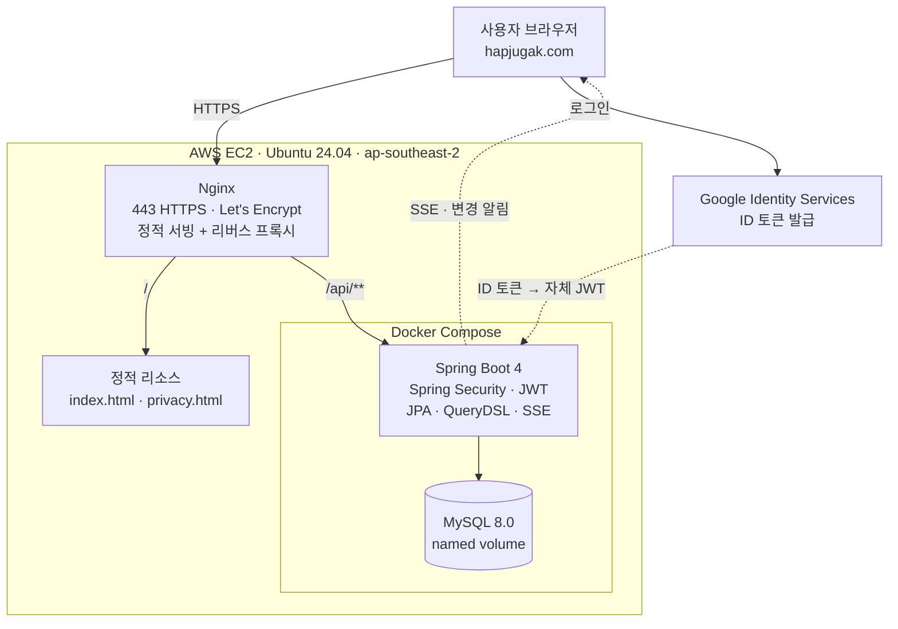

# 합주각 (Hapjugak)

밴드 합주 멤버를 모으는 서비스.
**Firebase(BaaS)로 운영하던 서비스를 Spring Boot 기반 자체 백엔드로 재설계하고, 운영 데이터와 프론트엔드까지 전부 이관한 프로젝트입니다.**

**→ https://hapjugak.com**

```
2026.08   Firebase + 정적 HTML 로 배포. 회원 26명이 곡 80건을 올리며 두 달 반 운영
2026.10   백엔드를 직접 만들어 AWS에 배포, 운영 데이터 이관, 프론트엔드 전환 완료
```

---

## 왜 만들었나

밴드 합주를 하려면 "이 곡 할 사람?" → "드럼 할게요" → "기타는 누가?" 를 카카오톡에서 반복해야 합니다.
누가 어느 파트인지 흩어지고, 중복 신청이 생기고, 언제까지 모집하는지도 흐지부지됩니다.

직접 겪은 문제라 Firebase로 먼저 만들어 배포했고, 실제 사용자를 받으며 운영했습니다.
그 과정에서 BaaS 구조의 한계를 만나 백엔드를 분리했습니다.

### Firebase에서 옮긴 이유

| 운영 중 만난 문제 | BaaS에서의 한계 | 현재 해결 방식 |
|---|---|---|
| 마감일이 지났는데 곡이 등록됨 | 검증이 클라이언트와 보안 규칙에 **이중 구현**되어 한쪽을 빠뜨리면 뚫림 | 서비스 계층 단일 메서드로 일원화 |
| 두 명이 동시에 같은 파트 신청 | Firestore 트랜잭션에 종속 | JPA 낙관적 락 + 통합 테스트로 검증 |
| 조건 조합 검색 (지역·파트·마감 여부) | 조합마다 인덱스를 따로 생성해야 함 | QueryDSL 동적 쿼리 |
| 참조 무결성 | 회원을 지워도 그 회원의 곡이 고아로 남음 | 외래키 제약으로 DB가 보장 |
| 권한 규칙 (관리자/주최자/작성자) | 보안 규칙 100여 줄, 테스트 불가 | Spring Security + 테스트 코드 |

**BaaS가 나빠서 옮긴 것이 아닙니다.** 소규모 서비스에 Firebase는 합리적인 선택이고, 운영 부담도 훨씬 적습니다.
위의 구체적인 한계에 부딪혀서 옮긴 것이고, 그 대가로 서버 운영 책임을 직접 지게 됐습니다.

---

## 기술 스택

| 분류 | 사용 기술 |
|---|---|
| Language | Java 17 |
| Framework | Spring Boot 4.1, Spring Security 7 |
| ORM | Spring Data JPA (Hibernate 7), QueryDSL 7 |
| Database | MySQL 8.0 |
| 실시간 | SSE (Server-Sent Events) |
| Auth | 자체 JWT (jjwt) + Google Identity Services |
| Test | JUnit 5, MockMvc |
| Build | Gradle |
| Infra | Docker Compose, AWS EC2 (Ubuntu 24.04), Nginx, Let's Encrypt |
| Frontend | 단일 HTML + 바닐라 JS (직접 작성) |

## 아키텍처



관리형 DB(RDS) 대신 **EC2 한 대에 애플리케이션과 MySQL을 함께** 올렸습니다. 월 $32 → $10.
대신 1GB 메모리 안에 둘을 넣어야 해서 `-Xmx400m`, `innodb-buffer-pool-size=128M`, 스왑 2GB로 조정했습니다.
트래픽이 커지면 DB를 분리하는 게 맞지만, 현재 규모에서는 비용이 더 중요한 제약이었습니다.

---

## 도메인 설계

```
Member ──주최──> Event ──포함──> Song ──구성──> Slot
   ▲                              ▲              │
   └──────────── 제안 ─────────────┘              │
   └───────────────── 점유 ───────────────────────┘
                                  └──기록──> ActivityLog
```

| 테이블 | 역할 |
|---|---|
| `member` | 회원. 자체 가입(LOCAL)과 구글 가입(GOOGLE)을 함께 지원 |
| `member_instrument` | 회원이 다루는 악기 (N개) |
| `event` | 합주 일정. 날짜, 시간, 합주실, 정원, 곡 신청 마감일, 완료 여부 |
| `event_default_part` | 그 합주에서 기본으로 잡는 파트 구성 |
| `song` | 곡. `event_id`가 **NULL이면 곡 후보**, 값이 있으면 일정에 배정됨 |
| `slot` | **파트 자리 하나**. 비어 있거나 한 명이 점유. 양도 가능 표시를 가짐 |
| `activity_log` | 누가 언제 어느 자리에 들어오고 나갔는지의 기록 |
| `site_settings` | 사이트 전역 설정. 행이 하나만 존재(id=1 고정) |

### `slot`을 별도 테이블로 분리한 이유

Firestore에서는 곡 문서 안에 `slots` 맵 필드로 담았습니다. 읽기는 간단했지만

- "이 회원이 참여한 모든 곡" 같은 역방향 조회가 불가능
- 자리 하나를 수정할 때 곡 문서 전체를 갱신 → 동시성 충돌 범위가 과도하게 넓음

관계형으로 옮기면서 행으로 펼쳐, **경합 단위를 자리 하나로 좁혔습니다.**

---

## 핵심 구현

### 1. 파트 선점 동시성 제어

같은 파트 자리를 여러 명이 동시에 신청할 수 있는 구조입니다.
엔티티에서 `if (이미 찼으면) 예외`로 막았지만, 두 요청이 동시에 들어오면 둘 다 "비어 있음"을 읽고 통과하는 경쟁 상태가 있었습니다.

```
t1  A: SELECT slot → member_id = null
t2  B: SELECT slot → member_id = null
t3  A: "비었네" 통과 → UPDATE member_id = A
t4  B: "비었네" 통과 → UPDATE member_id = B   ← A를 덮어씀
```

`@Version`으로 낙관적 락을 적용했습니다.

```sql
UPDATE slot SET member_id = ?, version = ? WHERE id = ? AND version = ?
```

나중에 커밋하는 트랜잭션이 0행을 수정하게 되어 예외가 발생하고,
`@RestControllerAdvice`에서 409로 변환해 사용자에게 재시도를 안내합니다.

**검증** — `CountDownLatch`로 10개 스레드를 동시에 출발시키는 통합 테스트

```
성공 1건, 실패 9건
```

`@Version`을 제거하면 성공 건수가 늘어나며 테스트가 실패합니다.

> **낙관적 락을 선택한 이유:** 슬롯 단위로 경합이 분산되어 동시 충돌 확률이 낮습니다.
> 비관적 락은 락 대기와 데드락 비용이 있는데 이 도메인에선 그만큼 충돌이 잦지 않습니다.
> 반대로 단일 재고를 다투는 선착순이라면 낙관적 락은 재시도 폭증으로 불리했을 것입니다.
>
> 다만 합주각은 **일정이 올라오는 순간에 사람이 몰리는** 서비스입니다. 평소 트래픽이 아니라
> 그 피크를 기준으로 설계했습니다.

### 2. 마감 검증 일원화

기존에는 클라이언트 버튼과 Firestore 보안 규칙 두 곳에서 각각 막았고, 한쪽을 빠뜨려 뚫렸습니다.
현재는 상태를 바꾸는 모든 경로가 단일 메서드를 거칩니다.

```java
private void checkOpen(Song song) {
    Event event = song.getEvent();
    if (event == null) return;
    if (event.isCompleted()) throw new ConflictException("이미 끝난 합주입니다.");
    if (event.isDeadlinePassed()) throw new ConflictException("마감된 일정입니다.");
}
```

마감 판단은 엔티티(`Event.isDeadlinePassed()`)가 책임집니다.
날짜를 문자열로 다루다 타임존 때문에 하루 밀리는 버그를 겪어, `LocalDate`로 고정하고 **경계값(전날·당일·다음날)을 테스트로 박아뒀습니다.**

### 3. 인증 — 구글 ID 토큰 검증

```
브라우저                     API 서버                 구글
   │ 구글 로그인 ──────────────────────────────────→ │
   │ ← ID 토큰                   │                   │
   │ POST /api/auth/google ────→ │ 서명·iss·aud 검증  │
   │                             │ 이메일로 회원 조회/생성
   │ ← 자체 JWT                  │
```

- 구글 ID 토큰은 `NimbusJwtDecoder`로 **공개키를 캐시해 로컬에서 검증**합니다 (매 요청 구글 호출 없음)
- **`aud`(수신자) 검증**을 반드시 수행합니다. 빠뜨리면 다른 앱에서 발급된 구글 토큰으로 로그인이 가능해집니다
- 이후 모든 API는 자체 JWT 한 가지 체계만 사용합니다
- **비밀번호를 저장하지 않습니다.** 자체 가입도 지원하지만, 현재 모든 회원이 구글 가입이라 `password`는 전부 `NULL`입니다

**계정 연동** — 같은 이메일로 자체 가입과 구글 로그인이 섞여도 중복 계정이 생기지 않도록, 이메일 기준으로 기존 회원에 provider를 연결합니다.

**인증 실패 메시지는 "이메일 없음"과 "비밀번호 틀림"을 구분하지 않습니다.** 계정 열거(account enumeration) 방지.

### 4. 동적 검색과 N+1

조건 4개(키워드 / 비어 있는 파트 / 곡 후보 여부 / 일정)의 조합은 16가지입니다.
메서드 이름 기반 쿼리로는 감당이 안 되어 QueryDSL을 도입했습니다.

```java
.where(
    keywordContains(song, cond.keyword()),   // 조건 없으면 null 반환
    candidateOnly(song, cond.candidateOnly()),
    eventIdEq(song, cond.eventId()),
    hasOpenPart(song, cond.openPart())       // exists 서브쿼리
)
```

`null`인 조건은 QueryDSL이 무시하므로, 자바 코드 한 벌로 모든 조합을 처리합니다.
동시에 `fetchJoin`으로 N+1을 제거했습니다. 곡 10개 조회 시 71개였던 쿼리가 1개가 됩니다.

> QueryDSL 원본(`com.querydsl`)은 유지보수가 멈춰 Hibernate 7과 호환되지 않아,
> 활발히 관리되는 **OpenFeign 포크**를 사용했습니다.

### 5. 실시간 갱신 — SSE

Firestore의 `onSnapshot`을 버리면서 "서버가 바뀌면 화면이 저절로 바뀌는" 기능을 잃었습니다.
임시로 5초 폴링을 썼더니 **하루 17,000번 요청 중 거의 전부가 헛걸음**이었습니다.
SSE로 교체해, 실제로 바뀐 순간에만 알립니다.

```java
@Component
public class ChangeNotifyFilter extends OncePerRequestFilter {
    // 쓰기 요청이 2xx로 끝나면 접속 중인 모든 브라우저에 신호를 보낸다
}
```

**설계에서 신경 쓴 세 가지**

| | 이유 |
|---|---|
| 신호에 **내용을 싣지 않음** | "바뀌었다"만 보내고 받은 쪽이 다시 조회합니다. 내용을 실으면 신호 순서가 뒤바뀌었을 때 화면이 서버와 어긋납니다 |
| 알림을 **필터 한 곳**에서 | 상태를 바꾸는 서비스 메서드가 14군데입니다. 전부에 `publish()`를 끼우면 서비스가 알림 걱정으로 더러워집니다 |
| **커밋 이후**에 알림 | `open-in-view=false`라 서비스 메서드가 끝나는 순간 트랜잭션이 끝납니다. 필터는 그 뒤에 돌기 때문에, 알림을 받고 조회하면 반드시 새 데이터가 보입니다 |

브라우저 쪽은 신호를 200ms 동안 묶어 한 번만 조회하고, 연결이 조용히 죽는 경우를 대비해 60초 간격의 느슨한 재조회를 안전망으로 남겼습니다.

---

## 운영 데이터 이관 (Firestore → MySQL)

토이 데이터가 아니라 **실제로 두 달 반 돌아간 서비스의 데이터**를 그대로 옮겼습니다.

```
회원      26명
합주 일정  2건
곡        80건
파트 자리  398개 (그중 117개 점유)
활동 로그  270건
```

### 문서형 → 관계형에서 실제로 걸린 것들

| 문제 | 어떻게 드러났나 | 처리 |
|---|---|---|
| **빈 문자열 ≠ NULL** | Firestore는 "값 없음"을 `""`로 저장. `LocalDate.parse("")` 에서 예외 | 읽는 쪽에서 빈 문자열을 `null`로 정규화 |
| **맵 → 행 전개** | `slots: {"Drum": {...}}` 를 `slot` 테이블 행으로 풀어야 함 | `requiredParts`로 자리를 먼저 만들고, 점유자를 찾아 채움 |
| **스키마가 데이터보다 작았음** | 커버 이미지·정원·시간대 등 15개 필드가 엔티티에 없었음 | 실데이터를 먼저 조사하고 엔티티를 확장한 뒤 이관 |
| **이미지가 컬럼에 안 들어감** | 프로필 사진이 URL이 아니라 **68KB base64**. `Data too long for column` | `LONGTEXT`로 변경. (본래는 객체 스토리지가 맞음 — "앞으로" 참고) |

### 이관 코드에 넣은 안전장치

| 장치 | 효과 |
|---|---|
| `@Profile("migrate")` | 평소 실행에는 빈으로 등록조차 되지 않음. 운영 중 오작동 불가 |
| `if (memberRepository.count() > 0) return;` | 멱등성. 두 번 돌려도 데이터가 중복되지 않음 |
| `@Transactional` | 실제로 컬럼 길이 초과로 중단됐을 때 **26건 전부 롤백**되어, 반쯤 이관된 상태가 남지 않았음 |

### 로그는 당시의 값을 복제해 저장한다

`activity_log`는 `actor`(FK)를 두고도 `actor_name`을 문자열로 **중복 저장**합니다. 의도한 비정규화입니다.

> 회원이 닉네임을 바꾸면, 조인으로 이름을 가져오는 방식은 **과거 로그의 이름까지 전부 바뀝니다.**
> 일어나지 않은 일이 기록에 남는 셈입니다. 기록은 그 시점의 값을 박아둬야 합니다.

같은 이유로 `type`은 enum이 아니라 `String`입니다. 로그 종류는 기능과 함께 늘어나는데, enum이면 새 값을 만난 과거 데이터를 읽다가 애플리케이션이 죽습니다. **고정된 값(파트·악기·권한)은 enum, 늘어나는 값(로그 종류)은 String** 으로 나눴습니다.

---

## 프론트엔드 이관 — 화면 코드를 건드리지 않고

기존 프론트엔드는 직접 만든 단일 HTML 파일(약 3,900줄)입니다.
Firestore 호출이 화면 곳곳에 흩어져 있었다면 사실상 다시 써야 했겠지만, **데이터 접근이 인터페이스 하나로 분리돼 있었습니다.**

```javascript
let store, auth = { ... };     // 교체 가능한 자리
// 구현 ①  Firestore
// 구현 ②  메모리(데모)
```

여기에 **세 번째 구현(우리 API용)을 끼워 넣는 것**으로 끝났습니다. 화면 코드 3,000여 줄은 한 줄도 바뀌지 않았습니다.

어댑터가 하는 일은 서버 JSON을 화면이 기대하는 모양으로 번역하는 것입니다.

| 서버 | → | 화면 |
|---|---|---|
| `slots: [{id, part:"VOCAL", memberId:16, taken}]` | | `slots: {Vocal:{uid:"16", name, open}}` |
| `eventId: null` | | `eventId: ""` |
| `instruments: ["GUITAR"]` | | `parts: ["일렉기타"]` |
| `createdAt: "2026-10-26T17:06:44"` | | `createdAt: 1792...` (숫자) |

> 옮기면서 발견한 것 하나 — 저는 "편성에서 파트를 빼도 이미 들어온 사람은 남겨야 한다"고 설계했는데,
> 프론트 코드에는 `// 더 이상 모집하지 않는 파트에 남아 있던 사람은 함께 비웁니다` 라고 적혀 있었습니다.
> **제 추측보다 실제 제품의 규칙이 우선**이라 백엔드를 그에 맞춰 되돌렸습니다.

---

## API

모든 주소 앞에 `/api` 가 붙습니다. Nginx가 `/api/**` 만 백엔드로 넘기고 나머지는 정적 파일로 응답합니다.

| Method | Path | 인증 | 설명 |
|---|---|---|---|
| POST | `/api/auth/google` | — | 구글 ID 토큰 → 자체 JWT |
| POST | `/api/auth/login` | — | 자체 로그인 |
| POST | `/api/members` | — | 회원가입 |
| GET · PUT | `/api/members/me` | 필요 | 내 정보 조회·수정 |
| GET | `/api/members` | ADMIN | 회원 목록 |
| DELETE | `/api/members/{id}` | ADMIN | 회원 삭제 |
| GET · POST | `/api/events` | 조회 — / 생성 필요 | 일정 목록·생성 |
| PATCH · DELETE | `/api/events/{id}` | 주최자·ADMIN | 일정 수정·삭제 |
| PATCH | `/api/events/{id}/complete` | 주최자·ADMIN | 합주 완료 |
| GET | `/api/events/completed` | — | 추억 저장소 |
| GET | `/api/songs` `?eventId=` | — | 곡 목록 |
| GET | `/api/songs/candidates` | — | 곡 후보 |
| GET | `/api/songs/search` | — | 동적 검색 |
| POST · PATCH · DELETE | `/api/songs` `/{id}` | 제안자·ADMIN | 곡 등록·수정·삭제 |
| PATCH | `/api/songs/{id}/event/{eventId}` | 필요 | 일정에 배정 / 해제 |
| POST · DELETE | `/api/songs/{id}/slots/{slotId}/claim` | 필요 | 파트 참여·취소 |
| POST | `.../slots/{slotId}/takeover` | 필요 | 양도된 자리 넘겨받기 |
| PATCH | `.../slots/{slotId}/handover` | 본인 | 양도 가능 표시 |
| PUT | `.../slots/{slotId}` | 주최자·ADMIN | 자리 강제 지정·비우기 |
| GET · POST | `/api/songs/{id}/logs` | 조회 — / 기록 필요 | 활동 기록 |
| GET · PUT | `/api/settings` | 조회 — / 수정 ADMIN | 사이트 설정 |
| GET | `/api/stream` | — | SSE 변경 알림 |

### 응답 규칙

| 코드 | 상황 |
|---|---|
| 401 | 토큰 없음 / 유효하지 않음 |
| 403 | 로그인했으나 권한 없음 (남의 자리, 주최자 전용, 관리자 전용) |
| 404 | 대상 없음 |
| 409 | 중복 이메일, 이미 찬 자리, 마감된 일정, 락 충돌 |

---

## 테스트

```
SlotTest, EventTest          8개   단위 — 스프링 없이 도메인 규칙만
SongServiceTest              9개   통합 — @Transactional 롤백으로 격리
SongApiTest                  3개   MockMvc — 인증·인가 규칙
SlotConcurrencyTest          1개   동시성 — 실제 MySQL
contextLoads                 1개
─────────────────────────────────
                            22개 / 약 30초
```

- 테스트는 **전용 스키마(`hapjugak_test`)** 를 `create-drop`으로 사용해 개발 데이터와 격리
- 동시성 테스트만 실제 MySQL에 붙입니다. 락 동작은 DB마다 달라 인메모리 DB로는 검증 의미가 없습니다

---

## 운영

### 자동 백업

매일 새벽 4시(KST) `mysqldump` → gzip → 14일치 보관.

```bash
0 19 * * * /home/ubuntu/backup.sh      # 서버는 UTC
```

> 같은 서버 안에 두는 백업이라 디스크 전체가 날아가면 같이 사라집니다.
> **"실수로 지웠을 때"를 막는 수준**이고, 객체 스토리지로 옮기는 것이 과제로 남아 있습니다.

### 개인정보 처리

회원 26명의 이메일·프로필 사진·지역을 저장하므로 [개인정보처리방침](https://hapjugak.com/privacy.html)을 공개하고 있습니다.
서버가 **AWS 시드니 리전**에 있어 개인정보 국외 이전에 해당하며, 이전 항목·시기·방법을 함께 고지합니다.

> 무료 플랜이 리전을 하나로 묶는 바람에 서울을 못 쓰고 시드니를 쓰게 됐는데,
> 그 선택이 **법적 고지 의무로 이어진** 경우입니다. 리전 선택은 지연 시간만의 문제가 아니었습니다.

---

## 실행 방법

```bash
# 1. 데이터베이스
CREATE DATABASE hapjugak      DEFAULT CHARACTER SET utf8mb4;
CREATE DATABASE hapjugak_test DEFAULT CHARACTER SET utf8mb4;

# 2. 환경변수 (없으면 서버가 뜨지 않습니다)
DB_PASSWORD=<MySQL 비밀번호>
JWT_SECRET=<32바이트 이상 문자열>

# 3. 실행
./gradlew bootRun
```

- 화면: `http://localhost:8080/api/index.html` (개발 중에는 스프링이 `frontend/` 를 직접 서빙)
- 민감정보는 코드에 두지 않고 환경변수로 주입합니다. **기본값도 두지 않습니다** — 설정을 빠뜨리면 공개된 키로 조용히 실행되는 쪽보다, 시끄럽게 죽는 쪽이 낫습니다.

### 서버 배포

```bash
git pull
sudo cp frontend/*.html /var/www/hapjugak/
docker compose up -d --build api
```

### Firestore 데이터 이관 (1회성)

```bash
./gradlew bootRun --args='--spring.profiles.active=migrate'
```

백업 JSON에는 실제 회원 정보가 들어 있어 `.gitignore`로 저장소에서 제외합니다.

---

## 앞으로

- [x] Docker 이미지화
- [x] AWS EC2 배포, Nginx + HTTPS
- [x] Firestore → MySQL 데이터 마이그레이션
- [x] 프론트엔드를 자체 API로 전환
- [x] SSE로 실시간 갱신 복원
- [x] 구글 로그인 직접 연동 (Firebase 제거)
- [x] DB 자동 백업
- [ ] GitHub Actions 무중단 배포
- [ ] 커버·프로필 이미지를 `LONGTEXT`에서 객체 스토리지로 이전
- [ ] `ddl-auto=update` → Flyway 기반 스키마 버전 관리
- [ ] 백업본을 서버 밖(S3)으로 이전
- [ ] 응답 페이징 — 곡이 수천 건이 되면 전체 조회가 버거워집니다
