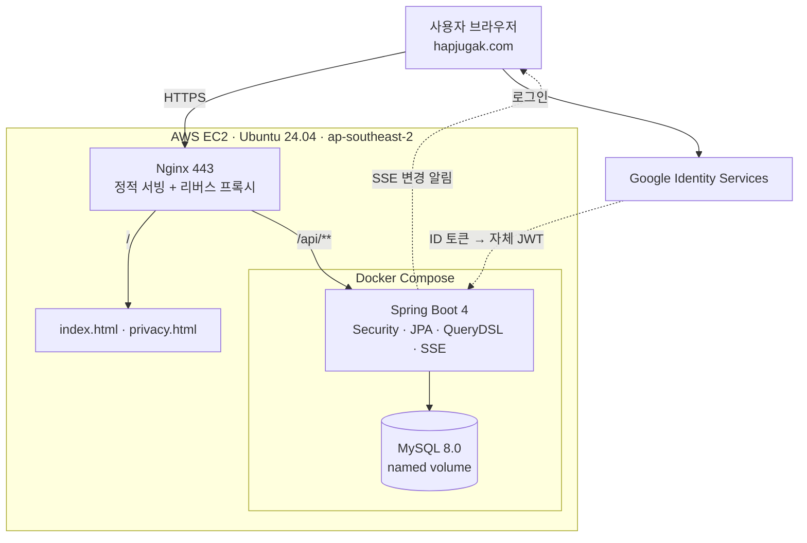

# 합주각 (Hapjugak)

밴드 합주 멤버를 파트별로 모으는 서비스입니다.
Firebase로 먼저 배포해 두 달 반 운영한 뒤, 운영 중 부딪힌 한계를 근거로 백엔드를 직접 만들어 재배포했습니다.

**서비스 → https://hapjugak.com**

---

## 개발자 소개

**장준호** · 백엔드 개발자 지원 · wnsgh409@gmail.com · [github.com/Junho2513](https://github.com/Junho2513)

제가 쓸 서비스를 먼저 배포해 사용자를 받고, 거기서 나온 문제를 근거로 다음 기술을 고릅니다.
합주각도 "Spring을 써보려고" 만든 게 아니라, Firebase로 두 달 반 운영하면서 동시성·검증·조회에서 막힌 뒤에 옮긴 쪽에 가깝습니다.
기술 선택마다 "안 옮겼으면 어땠을지"를 같이 적어두는 편입니다.

---

## 프로젝트 개요

| | |
|---|---|
| **기간** | 2026.08 ~ 운영 중 (Firebase 2.5개월 운영 → 10월 백엔드 재구축) |
| **인원** | 1명 |
| **역할** | 기획 · 프론트엔드 · 백엔드 · DB 설계 · 인프라 · 배포 전 과정 |
| **실사용 규모** | 회원 26명 · 곡 80건 · 파트 자리 398개 · 활동 로그 270건 |
| **운영 환경** | AWS EC2 1대 (t3.micro, ap-southeast-2) · 월 약 $10 |

---

## 왜 만들었나

합주각은 **여러 명이 모인 풀에서 매번 다른 조합으로 합주팟을 짜는 모임**을 위한 서비스입니다.

고정 멤버끼리 하는 밴드와 달리, 이런 모임은 누가 어느 곡에 어떤 파트로 들어갈지를 매번 처음부터 정해야 합니다. 사람이 많아질수록 그 조율이 기하급수적으로 어려워집니다.

### 한 곡도 성사되지 않는다

날짜를 잡고 단톡방에 "할 곡 추천받아요"를 올리면 추천곡이 우르르 올라옵니다. 스무 곡 넘게 쌓이기도 합니다. 여기까지는 좋은데, 그다음에 사람들이 각자 **자기가 제일 하고 싶은 곡에만** 손을 듭니다.

```
A곡 — 보컬 1
B곡 — 드럼 1
C곡 — 기타 1, 베이스 1
D곡 — 보컬 1
 ⋮     스무 곡에 한두 명씩 흩어짐
        → 한 곡도 성사되지 않음
```

사람은 충분한데 한 곡도 못 맞춥니다.

### 왜 흩어지는가

**지금 어느 곡에 누가, 어떤 파트로 들어가 있는지 볼 방법이 없기 때문**이라고 봤습니다.

C곡에 기타 한 명만 더 들어오면 합주가 성사된다고 해봅시다. 기타 치는 사람 입장에서 C곡이 1픽이 아니어도, "한 자리만 채우면 성사된다"는 걸 알면 들어갈 마음이 생깁니다. 그런데 그 정보가 어디에도 없습니다. 단톡방 수백 개 메시지를 거슬러 올라가며 직접 집계해야 알 수 있고, 아무도 그걸 하지 않습니다.

그래서 다들 자기 1픽에만 손을 들고, 모든 곡이 미완성으로 남습니다.

### 실제로 벌어진 일

합주실은 이미 예약해둔 상태에서 곡이 안 정해졌습니다. 현장에 모여서 "우리 오늘 뭐 하지", "이건 누가 치지"를 그 자리에서 정했습니다. 빌린 시간은 그동안 흘러갑니다.

스케줄 안내도 매번 수동이었습니다. 날짜·합주실·시간·참가비를 단톡방에 올리고, 못 본 사람에게 따로 알려주고, 바뀌면 또 올리고.

### 그래서 만든 것

단톡방에 메시지로 흩어져 있던 것들을 전부 **상태로 들고 있게** 만들었습니다. 곡 추천부터 자리 선점, 성립 여부, 일정 안내까지 한 화면에서 보이고 눌리도록요.

서비스를 떠받치는 기둥은 넷입니다.

| 기둥 | 겪은 문제 | 기능 |
|---|---|---|
| **곡 추천을 한곳에 모은다** | 추천곡이 메시지 사이에 묻혀 뭐가 나왔는지도 모름 | 곡 후보 목록에 쌓이고, 일정이 잡히면 거기서 골라 배정합니다 |
| **자리를 눈에 보이게 만든다** | 누가 어느 곡 어느 파트인지 집계가 안 됨 | 곡마다 파트 자리를 만들어 점유자와 빈자리를 함께 보여줍니다 |
| **자리를 선점할 수 있게 한다** | 같은 파트에 두 명이 신청하고, 이탈 메시지는 묻힘 | 한 자리에 한 명. 찬 자리는 버튼이 막히고, 못 가게 되면 양도로 넘깁니다 |
| **성립 여부를 알려준다** | 수요가 흩어져 한 곡도 성사되지 않음 | 다 차면 "성립" 표시가 붙고, **비어 있는 파트로 곡을 거를 수 있습니다** |

여기에 세 가지가 더 붙습니다.

| 겪은 문제 | 기능 |
|---|---|
| 합주 직전에 곡이 추가됨 | 일정마다 곡 신청 마감일이 있고, 지나면 서버가 거부합니다 |
| 스케줄 안내가 매번 수동 | 날짜·합주실·시간·참가비·정원을 일정에 담고, 바뀌면 접속 중인 모든 화면이 즉시 갱신됩니다 |
| 지난달에 뭘 했는지 아무도 기억 못 함 | 끝난 합주는 추억 저장소로 넘어가 곡과 참여자가 남습니다 |

뒤에 나오는 기술 선택은 전부 이 넷을 성립시키려고 한 것들입니다. **자리를 보이게** 하려고 `slot`을 별도 테이블로 뺐고, **선점**을 지키려고 낙관적 락을 걸었고, **성립 여부로 거르려고** `hasOpenPart` 동적 검색을 넣었고, 그 네 가지가 모든 사람 화면에서 동시에 맞으려고 SSE를 붙였습니다.

---

## 기술 스택

나열이 아니라 깊이를 구분해서 적습니다.

| 구분 | 기술 |
|---|---|
| **깊게 다룬 것** | Java 17 · Spring Boot 4.1 · Spring Data JPA (Hibernate 7) · MySQL 8.0 · QueryDSL · Spring Security + JWT · JUnit 5 |
| **직접 구성해 운영 중인 것** | Docker Compose · Nginx · AWS EC2 · GitHub Actions · Flyway · SSE · Let's Encrypt |
| **써본 것** | Firebase (Auth · Firestore) · Netlify |

### 이 조합을 고른 이유

- **QueryDSL** — 검색 조건 4개의 조합이 16가지입니다. 메서드 이름 기반 쿼리로는 메서드가 16개 필요한데, QueryDSL은 조건이 `null`이면 무시하므로 코드 한 벌로 끝납니다. 단순 CRUD는 기본 메서드를 그대로 씁니다.
- **낙관적 락** — 경합이 자리 단위로 잘게 쪼개져 충돌 확률이 낮습니다. 비관적 락은 락 대기 비용을 상시로 치르는데 이 도메인에선 수지가 안 맞습니다. 반대로 단일 재고를 다투는 선착순이었다면 재시도 폭증으로 불리했을 선택입니다.
- **SSE** — 서버에서 클라이언트로 한 방향만 보내면 됩니다. WebSocket은 양방향이 필요 없는데 연결 관리와 프록시 설정 부담만 늘어납니다.
- **EC2 한 대에 앱 + DB** — RDS를 붙이면 월 $32, 한 대에 몰면 $10입니다. 대신 1GB 메모리에 둘을 넣어야 해서 `-Xmx400m`, `innodb-buffer-pool-size=128M`, 스왑 2GB로 맞췄습니다. 트래픽이 커지면 DB부터 분리하는 게 맞습니다.

---

## 아키텍처



도메인 하나(`hapjugak.com`)로 정적 파일과 API를 함께 서빙합니다. Nginx가 `/api/**` 만 백엔드로 넘기고 나머지는 정적 파일로 응답합니다. CORS 설정이 필요 없고, 프론트와 백엔드가 같은 저장소·같은 배포에 묶입니다.

---

## 도메인 모델

```
Member ──주최──> Event ──포함──> Song ──구성──> Slot
   ▲                              ▲              │
   └──────────── 제안 ─────────────┘              │
   └───────────────── 점유 ───────────────────────┘
                                  └──기록──> ActivityLog
```

| 테이블 | 역할 |
|---|---|
| `member` | 회원. 자체 가입(LOCAL)과 구글 가입(GOOGLE) 모두 지원 |
| `event` | 합주 일정. 날짜, 합주실, 정원, 곡 신청 마감일, 완료 여부 |
| `song` | 곡. `event_id`가 NULL이면 아직 일정에 안 붙은 곡 후보 |
| `slot` | **파트 자리 하나.** 비어 있거나 한 명이 점유. 양도 가능 표시를 가짐 |
| `activity_log` | 누가 언제 어느 자리에 들어오고 나갔는지 |
| `site_settings` | 사이트 전역 설정. 행 하나 고정(id=1) |

### `slot`을 별도 테이블로 뺀 이유

Firestore에서는 곡 문서 안에 `slots` 맵 필드로 담았습니다. 읽기는 간단했지만 두 가지가 막혔습니다.

- "이 회원이 참여한 모든 곡" 같은 역방향 조회가 안 됩니다
- 자리 하나를 고치려면 곡 문서 전체를 갱신해야 해서, 서로 다른 파트를 신청한 두 사람이 충돌합니다

행으로 펼쳐서 경합 단위를 자리 하나로 좁혔습니다.

### 로그는 당시 값을 복제해 저장합니다

`activity_log`는 `actor`(FK)를 두고도 `actor_name`을 문자열로 중복 저장합니다. 조인으로 이름을 가져오면 회원이 닉네임을 바꿀 때 **과거 로그의 이름까지 전부 바뀝니다.** 일어나지 않은 일이 기록에 남는 셈입니다.

같은 이유로 `type`은 enum이 아니라 `String`입니다. 로그 종류는 기능과 함께 늘어나는데, enum이면 새 값이 생긴 뒤 과거 데이터를 읽다가 애플리케이션이 죽습니다. 고정된 값(파트·악기·권한)은 enum, 늘어나는 값은 String으로 나눴습니다.

---

## 트러블슈팅

### 1. 같은 파트 자리에 두 명이 동시에 들어간 문제

| | |
|---|---|
| **문제** | 일정이 올라온 직후 사람이 몰릴 때, 같은 파트를 두 명이 거의 동시에 신청하면 뒤 요청이 앞 요청을 덮어썼습니다 |
| **원인 분석** | 엔티티에서 `if (이미 찼으면) 예외`로 막고 있었지만, 두 요청이 동시에 "비어 있음"을 읽고 둘 다 통과했습니다. 읽기와 쓰기 사이에 틈이 있었습니다 |
| **해결** | `slot`에 `@Version`을 붙여 낙관적 락을 걸고, 발생한 예외를 `@RestControllerAdvice`에서 409로 변환해 재시도를 안내했습니다 |
| **결과** | `CountDownLatch`로 10개 스레드를 동시에 출발시키는 통합 테스트에서 **성공 1건 / 실패 9건**. `@Version`을 빼면 성공 건수가 늘어나며 테스트가 실패합니다 |
| **배운 점** | 애플리케이션 코드의 `if`는 동시성을 막지 못합니다. 경합은 DB가 보장하는 수단으로 막아야 합니다 |

```
t1  A: SELECT slot → member_id = null
t2  B: SELECT slot → member_id = null
t3  A: "비었네" 통과 → UPDATE member_id = A
t4  B: "비었네" 통과 → UPDATE member_id = B   ← A를 덮어씀
```

```sql
-- @Version 적용 후: 나중 트랜잭션은 0행을 수정하게 되어 예외가 발생합니다
UPDATE slot SET member_id = ?, version = ? WHERE id = ? AND version = ?
```

### 2. 곡 목록 조회에서 쿼리 71개

| | |
|---|---|
| **문제** | 곡 목록 화면이 느렸습니다 |
| **원인 분석** | `show-sql`로 찍어보니 곡 10건을 불러올 때 각 곡의 자리·점유자·일정을 지연 로딩하느라 **쿼리가 71개** 나가고 있었습니다 |
| **해결** | QueryDSL로 옮기면서 `fetchJoin`으로 연관 엔티티를 한 번에 가져오도록 바꿨습니다 |
| **결과** | **71개 → 1개**. 같은 화면에서 네트워크 왕복이 한 번으로 줄었습니다 |
| **배운 점** | 기능이 완성된 뒤가 아니라, 화면 하나당 몇 개의 쿼리가 나가는지를 만들면서 확인하는 습관을 들였습니다 |

조건 4개(키워드 / 비어 있는 파트 / 곡 후보 여부 / 일정)의 조합은 16가지입니다. 조건이 `null`이면 QueryDSL이 무시하므로 코드 한 벌로 전부 처리합니다.

```java
.where(
    keywordContains(song, cond.keyword()),     // 조건 없으면 null 반환
    candidateOnly(song, cond.candidateOnly()),
    eventIdEq(song, cond.eventId()),
    hasOpenPart(song, cond.openPart())         // exists 서브쿼리
)
```

> QueryDSL 원본(`com.querydsl`)은 유지보수가 멈춰 Hibernate 7과 호환되지 않아, 활발히 관리되는 OpenFeign 포크를 썼습니다.

### 3. 하루 17,000번의 헛된 요청

| | |
|---|---|
| **문제** | Firestore의 `onSnapshot`을 버리면서 "서버가 바뀌면 화면이 저절로 바뀌는" 기능을 잃었습니다. 임시로 5초 폴링을 넣었습니다 |
| **원인 분석** | 접속자 수 × 하루 요청을 세어보니 **하루 약 17,000건**이었고, 그중 실제로 데이터가 바뀐 경우는 수십 건이었습니다. 99% 이상이 "변한 거 없음" 응답이었습니다 |
| **해결** | SSE로 교체했습니다. 쓰기 요청이 2xx로 끝날 때만 접속 중인 모든 브라우저에 신호를 보냅니다 |
| **결과** | 요청 **17,000건/일 → 실제 변경 횟수만큼**. 반영 지연도 최대 5초에서 **1초 이내**로 줄었습니다 |
| **배운 점** | 폴링 간격을 줄이면 지연이 줄고 요청이 늘어납니다. 둘 다 잡으려면 간격이 아니라 방향을 바꿔야 했습니다 |

```java
@Component
public class ChangeNotifyFilter extends OncePerRequestFilter {
    // 쓰기 요청이 2xx로 끝나면 접속 중인 모든 브라우저에 신호를 보낸다
}
```

설계에서 신경 쓴 세 가지입니다.

| | 이유 |
|---|---|
| 신호에 **내용을 싣지 않음** | "바뀌었다"만 보내고 받은 쪽이 다시 조회합니다. 내용을 실으면 신호 순서가 뒤바뀌었을 때 화면이 서버와 어긋납니다 |
| 알림을 **필터 한 곳**에서 | 상태를 바꾸는 서비스 메서드가 14군데입니다. 전부에 `publish()`를 넣으면 서비스가 알림 걱정으로 지저분해집니다 |
| **커밋 이후**에 알림 | `open-in-view=false`라 서비스 메서드가 끝나는 순간 트랜잭션이 끝납니다. 필터는 그 뒤에 돌기 때문에, 알림을 받고 조회하면 반드시 새 데이터가 보입니다 |

브라우저 쪽은 신호를 200ms 동안 묶어 한 번만 조회하고, 연결이 조용히 끊기는 경우를 대비해 60초 간격의 느슨한 재조회를 안전망으로 뒀습니다.

### 4. 운영 데이터 이관이 26건 전부 롤백된 문제

| | |
|---|---|
| **문제** | Firestore → MySQL 이관 중 `Data too long for column 'photo_url'`로 중단됐습니다 |
| **원인 분석** | 컬럼 이름이 `photo_url`이라 URL일 거라고 가정했는데, 실제 값은 **base64 이미지(최대 68,863자)** 였습니다. 스키마를 데이터 확인 없이 만든 게 원인이었습니다 |
| **해결** | 필드를 `photoImage`로 바꾸고 `LONGTEXT`로 변경했습니다. 이관 전에 실데이터의 최대 길이와 타입을 먼저 조사하는 단계를 넣었습니다 |
| **결과** | `@Transactional` 덕분에 **26건 전부 롤백되어 반쯤 이관된 상태가 남지 않았습니다.** 재실행으로 회원 26 · 곡 80 · 자리 398 · 로그 270건 전부 이관 완료 |
| **배운 점** | 컬럼 이름은 데이터의 내용을 보장하지 않습니다. 이관은 스키마를 먼저 만드는 게 아니라 데이터를 먼저 조사하는 일입니다 |

문서형 → 관계형에서 함께 걸린 것들입니다.

| 문제 | 처리 |
|---|---|
| 빈 문자열 ≠ NULL — Firestore는 "값 없음"을 `""`로 저장해 `LocalDate.parse("")`에서 예외 | 읽는 쪽에서 `""`를 `null`로 정규화 |
| 맵 → 행 전개 — `slots: {"Drum": {...}}`를 `slot` 테이블 행으로 풀어야 함 | `requiredParts`로 자리를 먼저 만들고 점유자를 찾아 채움 |
| 스키마가 데이터보다 작았음 — 커버 이미지·정원·시간대 등 15개 필드가 엔티티에 없었음 | 실데이터를 조사하고 엔티티를 확장한 뒤 이관 |

이관 코드에 넣은 안전장치입니다.

| 장치 | 효과 |
|---|---|
| `@Profile("migrate")` | 평소 실행에는 빈으로 등록조차 되지 않음. 운영 중 오작동 불가 |
| `if (memberRepository.count() > 0) return;` | 멱등성. 두 번 돌려도 중복되지 않음 |
| `@Transactional` | 중단 시 전부 롤백 |

### 5. CI가 서버에 접속할 수 없었던 문제

| | |
|---|---|
| **문제** | GitHub Actions에서 SSH로 서버에 들어가 배포하려 했으나 `dial tcp ***:22: i/o timeout` |
| **원인 분석** | Security Group이 SSH를 제 IP에서만 허용하고 있었고, GitHub 러너의 IP는 실행마다 바뀝니다 |
| **해결** | 아래 세 선택지를 모두 버리고, 이미 열려 있는 443으로 **배포 신호만** 받는 구조로 바꿨습니다 |
| **결과** | 수동 배포(서버 접속 → `git pull` → 빌드 → 재시작, 서버에서 빌드하느라 수 분) → **푸시 후 1분 33초 자동 배포.** 새로 연 포트 0개 |
| **배운 점** | "접속할 방법"을 찾는 대신 "접속하지 않아도 되는 구조"를 찾으면 보안 요구와 자동화 요구가 충돌하지 않습니다 |

| 버린 선택지 | 이유 |
|---|---|
| 22번 포트를 `0.0.0.0/0` 으로 개방 | 공개된 SSH 포트는 상시 자동 로그인 시도의 대상이 됩니다 |
| GitHub Actions IP 대역만 허용 | 대역이 수천 개이고 수시로 바뀝니다. 유지보수가 불가능하고 실질적으로 전체 개방에 가깝습니다 |
| 서버가 주기적으로 당겨오기 (cron pull) | 포트는 안 열지만 최대 1분 지연이 생기고, 평소에는 대부분 헛돕니다 |

이 설계로 지킨 세 가지입니다.

- **새 포트를 열지 않았습니다.** 이미 쓰던 443 하나만 씁니다
- **CI가 서버 열쇠를 갖지 않습니다.** SSH 개인키를 GitHub Secret에 올리지 않습니다
- **호출자가 명령을 고를 수 없습니다.** 실행 대상이 `deploy.sh` 하나로 고정이라, 토큰이 유출돼도 할 수 있는 일은 재배포 한 번입니다

### 6. 에러 없이 조용히 아무 일도 일어나지 않은 문제

| | |
|---|---|
| **문제** | Flyway를 도입했는데 테스트 14개가 `missing table [activity_log]`로 실패했습니다. 빌드는 성공, 의존성도 받아졌는데 테이블이 없었습니다 |
| **원인 분석** | 로그를 `flyway`로 검색했더니 **0건**이었습니다. 실패한 게 아니라 아예 실행되지 않은 것이었습니다. Spring Boot 4부터 자동설정이 기술별 모듈로 분리돼, 라이브러리만 넣으면 Boot가 그 존재를 모릅니다 |
| **해결** | `flyway-core` 대신 자동설정 모듈까지 끌고 오는 `spring-boot-starter-flyway`로 교체했습니다 |
| **결과** | 테스트 22개 통과. 운영 서버는 기존 데이터를 건드리지 않고 기준선만 기록하고 정상 기동 |
| **배운 점** | 에러 메시지가 있는 버그는 검색하면 나옵니다. 아무 일도 일어나지 않는 버그는 "있어야 할 로그가 있는지"를 봐야 찾힙니다 |

```gradle
implementation 'org.flywaydb:flyway-core'                        // 아무 일도 일어나지 않음
implementation 'org.springframework.boot:spring-boot-starter-flyway'  // 자동설정 모듈 포함
```

---

## 설계 결정

### Firebase에서 옮긴 이유

| 운영 중 만난 문제 | BaaS에서의 한계 | 현재 |
|---|---|---|
| 마감일이 지났는데 곡이 등록됨 | 검증이 클라이언트와 보안 규칙에 **이중 구현**되어 한쪽을 빠뜨리면 뚫림 | 서비스 계층 단일 메서드로 일원화 |
| 두 명이 동시에 같은 파트 신청 | Firestore 트랜잭션에 종속 | JPA 낙관적 락 + 통합 테스트로 검증 |
| 조건 조합 검색 | 조합마다 인덱스를 따로 생성해야 함 | QueryDSL 동적 쿼리 |
| 참조 무결성 | 회원을 지워도 그 회원의 곡이 고아로 남음 | 외래키 제약으로 DB가 보장 |
| 권한 규칙 | 보안 규칙 100여 줄, 테스트 불가 | Spring Security + 테스트 코드 |

BaaS가 나빠서 옮긴 것은 아닙니다. 소규모 서비스에 Firebase는 합리적이고 운영 부담도 훨씬 적습니다. 위의 구체적인 한계에 부딪혀 옮겼고, 그 대가로 서버 운영 책임을 직접 지게 됐습니다.

### 마감 검증 일원화

기존에는 클라이언트 버튼과 Firestore 보안 규칙 두 곳에서 각각 막았고, 한쪽을 빠뜨려 뚫렸습니다. 지금은 상태를 바꾸는 모든 경로가 한 메서드를 거칩니다.

```java
private void checkOpen(Song song) {
    Event event = song.getEvent();
    if (event == null) return;
    if (event.isCompleted()) throw new ConflictException("이미 끝난 합주입니다.");
    if (event.isDeadlinePassed()) throw new ConflictException("마감된 일정입니다.");
}
```

마감 판단은 엔티티(`Event.isDeadlinePassed()`)가 책임집니다. 날짜를 문자열로 다루다 타임존 때문에 하루 밀리는 버그를 겪어 `LocalDate`로 고정하고, 경계값(전날·당일·다음날)을 테스트로 박아뒀습니다.

### 인증 — 구글 ID 토큰 검증

```
브라우저                     API 서버                 구글
   │ 구글 로그인 ──────────────────────────────────→ │
   │ ← ID 토큰                   │                   │
   │ POST /api/auth/google ────→ │ 서명·iss·aud 검증  │
   │                             │ 이메일로 회원 조회/생성
   │ ← 자체 JWT                  │
```

- 구글 ID 토큰은 `NimbusJwtDecoder`로 **공개키를 캐시해 로컬에서 검증**합니다 (매 요청 구글 호출 없음)
- **`aud`(수신자) 검증**을 반드시 합니다. 빠뜨리면 다른 앱에서 발급된 구글 토큰으로 로그인이 가능해집니다
- 이후 모든 API는 자체 JWT 한 가지 체계만 씁니다
- **비밀번호를 저장하지 않습니다.** 자체 가입도 지원하지만 현재 전 회원이 구글 가입이라 `password`는 전부 NULL입니다
- 인증 실패 메시지는 "이메일 없음"과 "비밀번호 틀림"을 구분하지 않습니다 (계정 열거 방지)

### 프론트엔드를 다시 쓰지 않은 방법

기존 프론트엔드는 직접 만든 단일 HTML 파일(약 3,900줄)입니다. Firestore 호출이 화면 곳곳에 흩어져 있었다면 다시 써야 했겠지만, 데이터 접근이 인터페이스 하나로 분리돼 있었습니다.

```javascript
let store, auth = { ... };     // 교체 가능한 자리
// 구현 ①  Firestore
// 구현 ②  메모리(데모)
```

여기에 **세 번째 구현(자체 API용)을 끼워 넣는 것**으로 끝났습니다. 화면 코드 3,000여 줄은 한 줄도 바뀌지 않았습니다. 어댑터가 하는 일은 서버 JSON을 화면이 기대하는 모양으로 번역하는 것뿐입니다.

| 서버 | → | 화면 |
|---|---|---|
| `slots: [{id, part:"VOCAL", memberId:16, taken}]` | | `slots: {Vocal:{uid:"16", name, open}}` |
| `eventId: null` | | `eventId: ""` |
| `instruments: ["GUITAR"]` | | `parts: ["일렉기타"]` |
| `createdAt: "2026-10-26T17:06:44"` | | `createdAt: 1792...` (숫자) |

옮기다 발견한 것 하나 — 저는 "편성에서 파트를 빼도 이미 들어온 사람은 남겨야 한다"고 설계했는데, 프론트 코드에는 `// 더 이상 모집하지 않는 파트에 남아 있던 사람은 함께 비웁니다`라고 적혀 있었습니다. 제 추측보다 실제 제품의 규칙이 우선이라 백엔드를 그에 맞춰 되돌렸습니다.

### 스키마 버전 관리 — 돌아가는 DB에 Flyway를 나중에 도입

처음에는 `ddl-auto=update`로 운영했습니다. 세 가지가 걸렸습니다.

- **지우거나 이름 바꾼 건 반영되지 않습니다.** `photo_url` → `photo_image` 로 바꿨더니 쓰지 않는 `photo_url`이 유령으로 남았습니다
- **변경 기록이 없습니다.** 운영 스키마 상태를 알려면 서버에 직접 들어가 봐야 했습니다
- **되돌릴 수 없습니다.** 배포는 커밋 해시로 롤백되는데 스키마는 방법이 없어 짝이 맞지 않습니다

빈 DB가 아니라 2개월 반치 데이터가 든 DB라, 운영 DB를 `mysqldump --no-data`로 떠서 `V1__baseline.sql`로 만들고 **기준선**으로 삼았습니다.

```properties
spring.jpa.hibernate.ddl-auto=validate
spring.flyway.baseline-on-migrate=true
spring.flyway.baseline-version=1
```

같은 파일이 환경에 따라 다르게 동작합니다.

| 환경 | DB 상태 | Flyway가 하는 일 |
|---|---|---|
| 운영 서버 | 테이블 8개 + 데이터 | **V1을 실행하지 않고** "v1 적용됨"만 기록. 데이터 무사 |
| CI · 새 개발 환경 | 빈 DB | V1을 **실제로 실행**해 테이블 생성 |

기준선에는 `FKnnys9e036wxawk8i4pf8g7htr` 같은 Hibernate 자동 생성 제약조건 이름이 가득했지만 그대로 뒀습니다. 운영 DB에 이미 그 이름으로 존재하기 때문입니다. 여기서 고치면 운영과 신규 환경의 스키마가 갈라집니다.

`validate`로 바꾼 뒤로는 엔티티에 필드를 추가하면 `V2__xxx.sql`을 같이 써야 합니다. 안 쓰면 테스트가 깨지고, 깨진 채로는 배포 단계로 내려가지 않습니다.

---

## API

모든 주소 앞에 `/api`가 붙습니다.

| Method | Path | 인증 | 설명 |
|---|---|---|---|
| POST | `/auth/google` · `/auth/login` | — | 구글 ID 토큰 / 자체 로그인 → JWT |
| POST | `/members` | — | 회원가입 |
| GET · PUT | `/members/me` | 필요 | 내 정보 조회·수정 |
| GET · DELETE | `/members` · `/members/{id}` | ADMIN | 회원 목록·삭제 |
| GET · POST | `/events` | 조회 — / 생성 필요 | 일정 목록·생성 |
| PATCH · DELETE | `/events/{id}` | 주최자·ADMIN | 일정 수정·삭제 |
| PATCH | `/events/{id}/complete` | 주최자·ADMIN | 합주 완료 |
| GET | `/events/completed` | — | 추억 저장소 |
| GET | `/songs` · `/songs/candidates` · `/songs/search` | — | 곡 목록 · 후보 · 동적 검색 |
| POST · PATCH · DELETE | `/songs` · `/songs/{id}` | 제안자·ADMIN | 곡 등록·수정·삭제 |
| PATCH | `/songs/{id}/event/{eventId}` | 필요 | 일정에 배정 / 해제 |
| POST · DELETE | `/songs/{id}/slots/{slotId}/claim` | 필요 | 파트 참여·취소 |
| POST · PATCH | `.../slots/{slotId}/takeover` · `/handover` | 필요 · 본인 | 자리 양도·넘겨받기 |
| PUT | `.../slots/{slotId}` | 주최자·ADMIN | 자리 강제 지정·비우기 |
| GET · POST | `/songs/{id}/logs` | 조회 — / 기록 필요 | 활동 기록 |
| GET · PUT | `/settings` | 조회 — / 수정 ADMIN | 사이트 설정 |
| GET | `/stream` | — | SSE 변경 알림 |

| 응답 코드 | 상황 |
|---|---|
| 401 | 토큰 없음 / 유효하지 않음 |
| 403 | 로그인했으나 권한 없음 (남의 자리, 주최자 전용, 관리자 전용) |
| 404 | 대상 없음 |
| 409 | 중복 이메일, 이미 찬 자리, 마감된 일정, 락 충돌 |

---

## 테스트

```
SlotTest, EventTest          8개   단위 — 스프링 없이 도메인 규칙만
SongServiceTest              9개   통합 — @Transactional 롤백으로 격리
SongApiTest                  3개   MockMvc — 인증·인가 규칙
SlotConcurrencyTest          1개   동시성 — 실제 MySQL
contextLoads                 1개
─────────────────────────────────
                            22개 / 약 30초
```

- 테스트 스키마는 엔티티가 아니라 **운영과 같은 마이그레이션 파일로** 만듭니다. 마이그레이션과 엔티티가 어긋나면 배포 전에 CI에서 먼저 터집니다
- 동시성 테스트만 실제 MySQL에 붙입니다. 락 동작은 DB마다 달라 인메모리 DB로는 검증 의미가 없습니다

---

## 배포 파이프라인

```
git push (master)
    │
    ├─ 테스트 22개 — MySQL 서비스 컨테이너에 V1 적용 후 실행      1분 4초
    │     실패하면 여기서 멈춤 (needs: test)
    │
    ├─ Docker 이미지 빌드 → GHCR에 :커밋해시 태그로 업로드         23초
    │
    └─ https://hapjugak.com/deploy-hook 에 토큰 헤더로 POST
            │
         Nginx(443) → 웹훅 데몬(127.0.0.1:9000) → 토큰 일치 시만
            │
         deploy.sh ─ flock 중복 실행 잠금
                   ├ docker manifest inspect 로 이미지 존재 확인
                   ├ git reset --hard <커밋>
                   ├ 프론트 HTML → /var/www/hapjugak
                   └ IMAGE_TAG=<커밋> docker compose up -d api     22초
                                                        ─────────────
                                                        총 1분 33초
```

### 배포 스크립트의 안전장치

| 장치 | 막는 상황 |
|---|---|
| `flock` | 연속 푸시로 배포가 겹쳐 돌며 서로를 덮어쓰는 것 |
| `docker manifest inspect` | 아직 업로드되지 않은 태그로 교체를 시도해 멀쩡히 돌던 컨테이너를 내려버리는 것 |
| 커밋 해시 태그 | `:latest`로는 지금 돌고 있는 게 어느 커밋인지 확인할 방법이 없습니다. 해시 태그면 `docker inspect` 한 줄로 확정됩니다 |

### 아직 무중단은 아닙니다

`docker compose up -d api`는 컨테이너를 내리고 새로 띄우므로 **수 초의 공백**이 있습니다. 새 컨테이너를 먼저 띄우고 헬스체크 후 Nginx upstream을 바꾸는 블루-그린이 필요한데, 현재 규모에서는 과하다고 보고 남겨뒀습니다.

---

## 운영

### 자동 백업

매일 새벽 4시(KST) `mysqldump` → gzip → 14일치 보관.

```bash
0 19 * * * /home/ubuntu/backup.sh      # 서버는 UTC
```

같은 서버 안에 두는 백업이라 디스크 전체가 날아가면 같이 사라집니다. "실수로 지웠을 때"를 막는 수준이고, 객체 스토리지로 옮기는 것이 과제로 남아 있습니다.

### 개인정보 처리

회원 26명의 이메일·프로필 사진·지역을 저장하므로 [개인정보처리방침](https://hapjugak.com/privacy.html)을 공개하고 있습니다. 서버가 AWS 시드니 리전에 있어 개인정보 국외 이전에 해당하며, 이전 항목·시기·방법을 함께 고지합니다.

무료 플랜이 리전을 묶는 바람에 서울 대신 시드니를 쓰게 됐는데, 그 선택이 법적 고지 의무로 이어진 경우입니다. 리전 선택은 지연 시간만의 문제가 아니었습니다.

---

## AI 활용과 검증

생성형 AI를 설계 논의와 코드 작성 보조에 썼습니다. 어디에 썼고 어떻게 검증했는지 구분해 적습니다.

| 영역 | AI 활용 | 제가 판단·검증한 것 |
|---|---|---|
| 도메인 설계 | 테이블 구조 후보 검토 | `slot` 분리, 로그 비정규화, enum/String 구분은 운영 중 겪은 문제를 근거로 직접 결정 |
| 동시성 처리 | 낙관적 락 코드 작성 보조 | `@Version` 유무로 테스트 결과가 갈리는 것을 직접 확인. 비관적 락과 비교해 선택 근거 정리 |
| 쿼리 최적화 | QueryDSL 문법 | 쿼리 71개를 `show-sql`로 직접 세고, `fetchJoin` 후 1개로 줄어든 것을 확인 |
| 인프라 구성 | Nginx·Compose·워크플로 초안 | 배포 실패 원인(compose 들여쓰기, `set -e`)을 로그로 직접 추적해 수정 |
| 데이터 이관 | 변환 코드 초안 | 실데이터의 길이·타입을 직접 조사. 롤백 원인(base64 68,863자)을 직접 규명 |

전체 22개의 테스트가 이 코드들의 검증 수단입니다. 동작을 확인하지 않은 코드는 반영하지 않았습니다.

---

## 실행 방법

```bash
# 1. 빈 데이터베이스만 만듭니다. 테이블은 Flyway가 만듭니다.
CREATE DATABASE hapjugak      DEFAULT CHARACTER SET utf8mb4;
CREATE DATABASE hapjugak_test DEFAULT CHARACTER SET utf8mb4;

# 2. 환경변수 (없으면 서버가 뜨지 않습니다)
DB_PASSWORD=<MySQL 비밀번호>
JWT_SECRET=<32바이트 이상 문자열>

# 3. 실행
./gradlew bootRun
```

- 화면: `http://localhost:8080/api/index.html` (개발 중에는 스프링이 `frontend/`를 직접 서빙)
- 민감정보는 환경변수로 주입하고 **기본값을 두지 않습니다.** 설정을 빠뜨리면 공개된 키로 조용히 실행되는 쪽보다 시끄럽게 죽는 쪽이 낫습니다
- 엔티티를 고치면 `src/main/resources/db/migration/`에 `V2__...sql`을 같이 써야 합니다

### Firestore 데이터 이관 (1회성)

```bash
./gradlew bootRun --args='--spring.profiles.active=migrate'
```

백업 JSON에는 실제 회원 정보가 들어 있어 `.gitignore`로 저장소에서 제외합니다.

---

## 앞으로

- [x] Firebase → 자체 백엔드 전환 (API · 인증 · 실시간)
- [x] 운영 데이터 이관 (회원 26 · 곡 80 · 자리 398 · 로그 270)
- [x] AWS EC2 배포, Nginx + HTTPS, DB 자동 백업
- [x] GitHub Actions 자동 배포 (SSH 포트를 열지 않는 웹훅 방식)
- [x] Flyway 기반 스키마 버전 관리 (운영 DB를 기준선으로 도입)
- [ ] 커버·프로필 이미지를 `LONGTEXT`에서 객체 스토리지로 이전
- [ ] 백업본을 서버 밖(S3)으로 이전
- [ ] 응답 페이징 — 곡이 수천 건이 되면 전체 조회가 버거워집니다
- [ ] 블루-그린으로 배포 공백 제거
